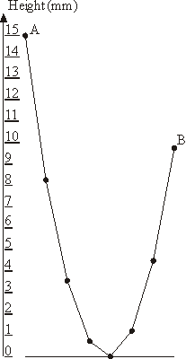
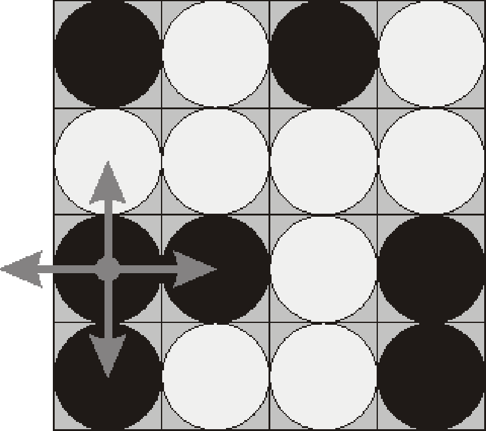
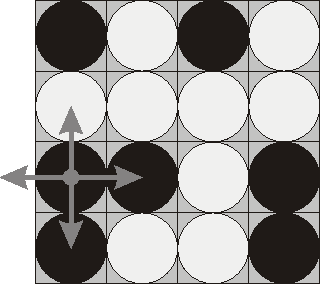

# Feladatleírások - 2003

## Diplomats

### Dining Diplomats

You have been hired to arrange the seating of diplomats at a dinner party. Your employer has invited 9 diplomats from several countries around the world. Each diplomat will speak from one to five languages. Diplomats not speaking a common language can not talk to each other. Furthermore, some of the countries represented will not have diplomatic relations with other nations represented, so these diplomats will not be speaking to each other either. Your task is to determine the seating arrangement at the dinner table for your employer and the 9 guests such that each person can speak to the person seated on each side.\

The table to be used for dinner is round, and seats 10 people. Your employer will be seated at the first position at the table. The other positions will be numbered clockwise from 2 to 10. The person seated to the left of your employer is in seat number 2, the person seated to the right of your employer is in seat number 10.\

Persons seated next to each other must speak a common language. A person may speak to the person on the left in one common language, and speak to the person on the right in another language. The governments of the guests seated next to each other must have formally recognized each other.\

The government of your employer has diplomatic relations with the governments of all of his guests. The government of a guest may or may not have diplomatic relations with the governments of all the other guests.\

Two diplomats from the same country will have diplomatic relations with the same list of countries. A country will always have diplomatic relations with itself. Diplomats from the same country may or may not speak any languages in common.\

Input to the program will be a list of ten people, one per line, ended by end-of-file. The first line will represent your employer, the other lines will represent the guest diplomats. Each line consists of a sequence of words, where words are separated by a single space. Each word is a sequence of capitals. The first word consists of 3 characters and represents the code for the guest's country. The second word contains 1 to 5 characters and represents the languages that the guest speaks. Each language that the guest speaks is represented by a single letter. Finally, thereis a list of up to 9 three-character words representing the codes of the countries of the other guests that this guest's government has diplomatic relations with.\

Output of the program is a table of the seating arrangement. It contains one diplomat per line. Each line starts with the seat number followed by three words, all separated by single spaces. The first word is the language code for the person seated on the left. The second word is the country code for the diplomat. The third word is the language code for the person seated on the right. The seating arrangement should be printed in the order 1 to 10, and no blank line should appear after line 10. More than one solution may exist, but you need find only one. If no solution is found, output the sentence

    NO SOLUTION EXISTS

##### 1. sor

###### 1. oszlop

#### Sample Input:

    USA EF CHN GBR USR FRA FRG JPN ISR POR KOR
    CHN CFE USA GBR FRA FRG
    GBR ER USA CHN USR FRA FRG JPN ISR POR KOR
    USR RF USA GBR FRA FRG
    FRA F USA CHN GBR USR FRG JPN ISR POR
    FRG ERG USA CHN GBR USR FRA JPN ISR POR
    JPN JHG USA GBR FRA FRG JPN ISR POR KOR
    ISR HER USA GBR FRA FRG JPN KOR
    POR PGE USA GBR FRA FRG JPN
    KOR KEC USA GBR USR JPN ISR

###### 2. oszlop

###### 3. oszlop

#### Sample Output

    1 E USA E
    2 E KOR E
    3 E ISR H4 H JPN G5 G FRG G
    6 G POR E
    7 E GBR E
    8 E USR F
    9 F FRA F
    10 F CHN E

## Skyscraper

### Skyscraper Floors

(**file name:** `floors.c, floors.p, floors.C`)

What a great idea it is to build skyscrapers! Using not too large area of land, which is very expensive in many cities today, the skyscrapers offer an extremely large utility area for flats or offices. The only disadvantage is that it takes too long to get to the upper floors. Of course these skyscrapers have to be equiped not only with a stairway but also with several elevators. But even using ordinary elevators is very slow. Just imagine you want to get from the very top floor to the base floor and many other people on other floors want the same. As a result the elevator stops on almost every floor and since its capacity is limited and the elevator is already full from the upper floors, most stops are useless and just cause a delay. If there are more elevators in the skyscrapers, this problem is a little bit eliminated but still not completely. Most people just press all the buttons of all the elevators and then take the first one so that all elevators will stop on the floor anyway.

However, the solution exists as we shall see. The Antique Comedians of Midilesia headquarters reside in a skyscraper with a very special elevator system. The elevators do not stop on every floor but only on every `X`-th floor. Moreover each elevator can go just to a certain floor `Y` (called starting floor) and cannot go any lower. There is one high-capacity elevator which can stop on every elevator's starting floor.

The ACM has a big problem. The headquarters should be moved to another office this week, possibly on a different floor. Unfortunately, the high-capacity elevator is out of order right now so it is not always possible to go to the base floor. One piece of furniture cannot be moved using the stairway because it is too large to pass through the stairway door. You are to write a program that decides whether it is possible to move a piece of furniture from the original office to the other.

#### Input Specification

The input consists of `N` cases. The first line contains only one positive integer `N`. Then follow the cases. Each case starts with a line containing four integers `F`, `E`, `A`, `B`, where `F`, `1 <= F < 50000000` determines the number of floors in the skyscraper (this means that there are floors `0` to `F-1`), `E`, `0 < E < 100` is the number of elevators and `A`, `B`, `0 <= A,B < F` are numbers of the two floors between which the piece of furniture should be moved. Then follow `E` lines. Each of them contains description of one elevator. There are exactly two integers `X` and `Y`, `X > 0`, `Y >= 0` at each line. `Y` determines, that the elevator starts on the `Y`-th floor and `X` determines, that it stops on every `X`-th floor, eg. for `X = 3`, `Y = 7` the elevator stops on floors 7, 10, 13, 16, etc.).

#### Output Specification

For each case, print exactly one line. If floor `B` is reachable from floor `A` not using the stairway, print the sentence '`It is possible to move the furniture.`', otherwise print '`The furniture cannot be moved.`'.

##### 1. sor

###### 1. oszlop

#### Sample Input

    2
    22 4 0 6
    3 2
    4 7
    13 6
    10 0
    1000 2 500 777
    2 0
    2 1

###### 2. oszlop

#### Output for the Sample Input

    It is possible to move the furniture.
    The furniture cannot be moved.

## Books

### Copying Books

(**file name:** `books.c, books.p, books.C`)

Before the invention of book-printing, it was very hard to make a copy of a book. All the contents had to be re-written by hand by so called *scribers*. The scriber had been given a book and after several months he finished its copy. One of the most famous scribers lived in the 15th century and his name was Xaverius Endricus Remius Ontius Xendrianus (*Xerox*). Anyway, the work was very annoying and boring. And the only way to speed it up was to hire more scribers.

Once upon a time, there was a theater ensemble that wanted to play famous Antique Tragedies. The scripts of these plays were divided into many books and actors needed more copies of them, of course. So they hired many scribers to make copies of these books. Imagine you have `m` books (numbered `1, 2 ... m`) that may have different number of pages (`p`_(`1`)`, p`_(`2`)` ... p`_(`m`)) and you want to make one copy of each of them. Your task is to divide these books among `k` scribes, `k <= m`. Each book can be assigned to a single scriber only, and every scriber must get a continuous sequence of books. That means, there exists an increasing succession of numbers `0 = b`_(`0`)` < b`_(`1`)` < b`_(`2`)`, ... < b`_(`k-1`)` <= b`_(`k`)` = m` such that `i`-th scriber gets a sequence of books with numbers between `b`_(`i-1`)`+1` and `b`_(`i`). The time needed to make a copy of all the books is determined by the scriber who was assigned the most work. Therefore, our goal is to minimize the maximum number of pages assigned to a single scriber. Your task is to find the optimal assignment.

#### Input Specification

The input consists of `N` cases. The first line of the input contains only positive integer `N`. Then follow the cases. Each case consists of exactly two lines. At the first line, there are two integers `m` and `k`, `1 <= k <= m <= 500`. At the second line, there are integers `p`_(`1`)`, p`_(`2`)`, ... p`_(`m`) separated by spaces. All these values are positive and less than 10000000.

#### Output Specification

For each case, print exactly one line. The line must contain the input succession `p`_(`1`)`, p`_(`2`)`, ... p`_(`m`) divided into exactly `k` parts such that the maximum sum of a single part should be as small as possible. Use the slash character ('`/`') to separate the parts. There must be exactly one space character between any two successive numbers and between the number and the slash.

If there is more than one solution, print the one that minimizes the work assigned to the first scriber, then to the second scriber etc. But each scriber must be assigned at least one book.

#### Sample Input

    2
    9 3
    100 200 300 400 500 600 700 800 900
    5 4
    100 100 100 100 100

#### Output for the Sample Input

    100 200 300 400 500 / 600 700 / 800 900
    100 / 100 / 100 / 100 100

## Highways

Highways

## 1999-2000 ACM Northeastern European Regional Programming Contest

### Problem G\
"Highways"

|  |
| --- |
| Input file `HIGHWAYS.IN` Output file `HIGHWAYS.OUT` Time limit 15 seconds per test |
| Output file `HIGHWAYS.OUT` Time limit 15 seconds per test |
| Time limit 15 seconds per test |

The island nation of Flatopia is perfectly flat. Unfortunately, Flatopia has a very poor system of public highways. The Flatopian government is aware of this problem and has already constructed a number of highways connecting some of the most important towns. However, there are still some towns that you can't reach via a highway. It is necessary to build more highways so that it will be possible to drive between any pair of towns without leaving the highway system.

Flatopian towns are numbered from 1 to *N* and town *i* has a position given by the Cartesian coordinates (*x_(i)*, *y_(i)*). Each highway connects exaclty two towns. All highways (both the original ones and the ones that are to be built) follow straight lines, and thus their length is equal to Cartesian distance between towns. All highways can be used in both directions. Highways can freely cross each other, but a driver can only switch between highways at a town that is located at the end of both highways.

The Flatopian government wants to minimize the cost of building new highways. However, they want to guarantee that every town is highway-reachable from every other town. Since Flatopia is so flat, the cost of a highway is always proportional to its length. Thus, the least expensive highway system will be the one that minimizes the total highways length.

#### Input

The input file consists of two parts. The first part describes all towns in the country, and the second part describes all of the highways that have already been built.

The first line of the input file contains a single integer *N* (1 ≤ *N* ≤ 750), representing the number of towns. The next *N* lines each contain two integers, *x_(i)* and *y_(i)* separated by a space. These values give the coordinates of *i*^(th) town (for *i* from 1 to *N*). Coordinates will have an absolute value no greater than 10000. Every town has a unique location.

The next line contains a single integer *M* (0 ≤ M ≤ 1000), representing the number of existing highways. The next *M* lines each contain a pair of integers separated by a space. These two integers give a pair of town numbers which are already connected by a highway. Each pair of towns is connected by at most one highway.

#### Output

Write to the output file a single line for each new highway that should be built in order to connect all towns with minimal possible total length of new highways. Each highway should be presented by printing town numbers that this highway connects, separated by a space.

If no new highways need to be built (all towns are already connected), then the output file should be created but it should be empty.

#### Sample input

    9
    1 5
    0 0
    3 2
    4 5
    5 1
    0 4
    5 2
    1 2
    5 3
    3
    1 3
    9 7
    1 2
    2 3

#### Sample output for the sample input

    1 6
    3 7
    4 9
    5 7
    8 3

## Package

### 1994 ACM Scholastic Programming Contest Finals

##### sponsored by Microsoft ®

### Problem D\
Package Pricing

The Green Earth Trading Company sells 4 different sizes of energy-efficient fluorescent light bulbs for use in home lighting fixtures. The light bulbs are expensive, but last much longer than ordinary incandescent light bulbs and require much less energy. To encourage customers to buy and use the energy-efficient light bulbs, the company catalogue lists special packages which contain a variety of sizes and numbers of the light bulbs. The price of a package is always substantially less than the total price of the individual bulbs in the package. Customers typically want to buy several different sizes and numbers of bulbs. You are to write a program to determine the least expensive collection of packages that satisfy any customer's request.

#### Input

The input file is divided into two parts. The first one describes the packages which are listed in the catalogue. The second part describes individual customer requests. The 4 sizes of light bulbs are identified in the input file by the characters "`a`", "`b`", "`c`", and "`d`".

The first part of the input file begins with an integer n (1\<= n \<=50) indicating the number of packages described in the catalogue. Each of the *n* lines that follows is a single package description. A package description begins with a catalogue number (a positive integer) followed by a price (a real number), and then the sizes and corresponding numbers of the light bulbs in the package. Between 1 and 4 different sizes of light bulbs will be listed in each description. The listing format for these size-number pairs is a blank, a character ("`a`", "`b`", "`c`", or "`d`") representing a size, another blank, and then an integer representing the number of light bulbs of that size in the package. These size-number pairs will not appear in any particular order, and there will be no duplicate sizes listed in any package. The following line describes a package with catalogue number 210 and price \$76.95 which contains 3 size "`a`" bulbs, 1 size "`c`" bulb, and 4 size "`d`" bulbs.

            210 76.95 a 3 c 1 d 4

The second part of the input file begins with a line containing a single positive integer m representing the number of customer requests. Each of the remaining *m* lines is a customer request. A listing of sizes and corresponding numbers of light bulbs constitutes a request. Each list contains only the size-number pairs, formatted the same way that the size-number pairs are formatted in the catalogue descriptions. Unlike the catalogue descriptions, however, a customer request may contain duplicate sizes. The following line represents a customer request for 1 size "`a`" bulb, 2 size "`b`" bulbs, 2 size "`c`" bulbs, and 5 size "`d`" bulbs.

       a 1 d 5 b 1 c 2 b 1

#### Output

For each request, print the customer number (1 through *m*, 1 for the first customer request, 2 for the second, ..., *m* for the *m*^(th) customer), a colon, the total price of the packages which constitute the least expensive way to fill the request, and then the combination of packages that the customer should order to fill that request.

Prices should be shown with exactly two significant digits to the right of the decimal. The combination of packages must be written in ascending order of catalogue numbers. If more than one of the same type package is to be ordered, then the number ordered should follow the catalogue number in parentheses. You may assume that each customer request can be filled. In some cases, the least expensive way to fill a customer request may contain more light bulbs of some sizes than necessary to fill the actual request. This is acceptable. What matters is that the customers receive *at least* what they request.

#### Sample Input

    5
    10 25.00 b 2
    502 17.95 a 1
    3 13.00 c 1
    55 27.50 b 1 d 2 c 1
    6 52.87 a 2 b 1 d 1 c 3
    6
    d 1
    b 3
    b 3 c 2
    b 1 a 1 c 1 d 1 a 1
    b 1 b 2 c 3 c 1 a 1 d 1
    b 3 c 2 d 1 c 1 d 2 a 1

#### Output for the Sample Input

    1:   27.50 55
    2:   50.00 10(2)
    3:   65.50 3 10 55
    4:   52.87 6
    5:   90.87 3 6 10
    6:  100.45 55(3) 502

## Expressions

|  |  |
| --- | --- |
|  | ##### # Expressions |

##### 1. sor

###### 1. oszlop

Little Michael got a really interesting present last Christmas. It was a box full of colorful tiles with fancy symbols. After a closer inspection, Michael found out that there were several types of tiles. There were red tiles displaying symbols "**+**", "**\***", "**!**", green tiles with symbols "**(**" and "**)**", and a few blue tiles with large symbols "**1**" across their faces.

Michael soon realized that red tiles represented mathematical operations: **+** stood for addition, **\*** for multiplication, **!** for the factorial function. (The factorial of a positive integer **n** is defined as the product of all positive integers less than or equal to **n**, i.e. **n! = n(n-1)(n-2)...2.1**.) Green tiles certainly represented left and right parentheses. But why were there only a few blue tiles and each of them had a **1** on its top?

The brochure he found in the box after taking all the tiles out said that the game was named "*Express your number*". It claimed that the game is a great companion for his free time and is good for players of all skills and ages. It went further explaining that the point of the game is to find an expression consisting of additions, multiplications, factorials, parentheses and numbers **1** that would evaluate to a given number **n**. The brochure also contained a list of sample numbers and encouraged him to find expressions for them. Michael soon realized that since there were only a few blue tiles, he had to find expressions that would not contain too many **1**s. Now he is trying to express every number by an expression that contains as few **1**s as possible.

Formally,

1.  **1** is an expression.
2.  If **e** is an expression then **(e)** and **e`!`** are expressions.
3.  If **e₁** and **e₂** are expressions then **e₁`+`e₂** and **e₁`*`e₂** are expressions.
4.  Nothing else is considered to be an expression.

Expressions are evaluated using standard precedence rules (i.e. `!` has the highest priority, followed by `*` with a lower priority and `+` with the lowest priority). Note that it is not possible to obtain a number by concatenating digits, i.e. **11** is not a valid expression.

#### Input file specification

The input file contains a list of positive integers, one per line. The list is terminated by the number `-1`, which should not be processed.

#### Output file specification

Express each number in the input file by an expression that contains the minimum number of **1**s. If there are multiple such expressions, output an arbitrary one of them. For technical reasons, we allow only expressions that consist of **no more than 10000 symbols**. Output an empty line after each expression. You can delimit characters in your expression by spaces and divide your expression into multiple lines. Do not insert any blank lines inside expressions!

#### Example

**Input file:**

    18
    5040
    11
    -1

**Output file:** (out of several possibilities)

    (1+1+1)*(1+1+1)!

    ((1+1+1)!+1)!

    ((1+1+1+1)+1)*(1+1)+1

## Gardening

|  |
| --- |
| ##### # Gardening |

##### 1. sor

###### 1. oszlop

Banto and Santo inherited a Precious plant garden from their uncle Manto. The Precious plant is a very strange plant. It is one-dimensional, the only dimension being its height. Viewed from above it looks like a point. The garden is a square 50 by 50 meters. It has to be split into two parts. Santo (as he is very lazy) does not want to do the work so he told Banto: "Just split the garden, but make sure that my part is a square with its sides parallel to the sides of the original garden and that it contains at least half of the Precious plant trees." Banto agreed to do this but he added one condition: Santo's part must have the smallest area possible.

Banto measured positions of all Precious plant trees in the garden and typed them into the computer. Now he is trying to determine the smallest square that contains at least half of the Precious plant trees. A plant is contained in a square if it is inside it or on its border. It is not an easy problem. Go! Help him!

#### Input file specification

The input file contains the number of Precious plant trees on the first line. Each of the following lines contains two numbers specifying the position of a Precious plant. Coordinates are measured from the south-west corner of the garden, parallel to its sides, in meters, with infinite precision. All numbers in the file are distinct (this comes from a rule about growing Precious plants that we will not explain here).

#### Output file specification

The output file should contain two lines with two numbers each: coordinates of arbitrary two opposing corners of the minimal square containing at least half of the Precious plant trees.

#### Example

**Input file:**

    4
    1.23 4.14
    6.02 3
    5 6
    10 4.5

**Output file:** (out of several possibilities)

    4 3
    7 6

## Garland

### Problem G\
"Garland"

|  |  |
| --- | --- |
| **Input file** | `GARLAND.IN` |
| **Output file** | `GARLAND.OUT` |
| **Time limit** | 15 seconds per test |



The New Year garland consists of *N* lamps attached to a common wire that hangs down on the ends to which outermost lamps are affixed. The wire sags under the weight of lamp in a particular way: each lamp is hanging at the height that is 1 millimeter lower than the average height of the two adjacent lamps.

The leftmost lamp in hanging at the height of *A* millimeters above the ground. You have to determine the lowest height *B* of the rightmost lamp so that no lamp in the garland lies on the ground though some of them may touch the ground.

You shall neglect the lamp's size in this problem. By numbering the lamps with integers from 1 to *N* and denoting the *i*^(th) lamp height in millimeters as *H_(i)* we derive the following equations:

- *H*₁ = *A*
- *H_(i)* = (*H*_(*i*-1) + *H*_(*i*+1))/2 - 1, for all 1 \< *i* \< *N*
- *H*_(*N*) = *B*
- *H_(i)* ≥ 0, for all 1 ≤ *i* ≤ *N*

The sample garland with 8 lamps that is shown on the picture has *A* = 15 and *B* = 9.75.

#### Input

The input file consists of a single line with two numbers *N* and *A* separated by a space. *N* (3 ≤ N ≤ 1000) is an integer representing the number of lamps in the garland, *A* (10 ≤ A ≤ 1000) is a real number representing the height of the leftmost lamp above the ground in millimeters.

#### Output

Write to the output file the single real number *B* accurate to two digits to the right of the decimal point representing the lowest possible height of the rightmost lamp.

##### 1. sor

###### 1. oszlop

#### Sample input \#1

```
8 15
```

#### Output for the sample input \#1

```
9.75
```

###### 2. oszlop

#### Sample input \#2

```
692 532.81
```

#### Output for the sample input \#2

```
446113.34
```

## Candy

|  |
| --- |
| ##### # Candy |

##### 1. sor

###### 1. oszlop

Jennifer is a teacher in the first year of a primary school. She has gone for a trip with her class today. She has taken a packet of candies for each child. Unfortunatelly, the sizes of the packets are not the same.

Jennifer is afraid that each child will want to have the biggest packet of candies and this will lead to quarrels or even fights among children. She wants to avoid this. Therefore, she has decided to open all the packets, count the candies in each packet and move some candies from bigger packets to smaller ones so that each packet will contain the same number of candies. The question is how many candies she has to move.

#### Input specification

The input file consists of several blocks of data. Each block starts with the number of candy packets **N** followed by **N** integers giving the number of candies in each packet. After the last block of data there is the number -1.

#### Output specification

The output file should contain one line with the smallest number of moves for each block of data. One move consists of taking one candy from a packet and putting it into another one. If it is not possible to have the same number of candies in each packet, output the number -1.

#### Example

**Input file:**

    5\
    1 1 1 1 6
    2
    3 4
    -1

**Output file:**

    4
    -1

## Flip



### Problem A\
"Flip Game"

|  |  |
| --- | --- |
| **Input file** | `FLIP.IN` |
| **Output file** | `FLIP.OUT` |
| **Time limit** | 15 seconds per test |

Flip game is played on a rectangular 4x4 field with two-sided pieces placed on each of its 16 squares. One side of each piece is white and the other one is black and each piece is lying either it's black or white side up. Each round you flip 3 to 5 pieces, thus changing the color of their upper side from black to white and vice versa. The pieces to be flipped are chosen every round according to the following rules:

1.  Choose any one of the 16 pieces.
2.  Flip the chosen piece and also all adjacent pieces to the left, to the right, to the top, and to the bottom of the chosen piece (if there are any).

 Consider the following position as an example:

```
bwbw
wwww
bbwb
bwwb
```

Here "b" denotes pieces lying their black side up and "w" denotes pieces lying their white side up. If we choose to flip the 1st piece from the 3rd row (this choice is shown at the picture), then the field will become:

```
bwbw
bwww
wwwb
wwwb
```

The goal of the game is to flip either all pieces white side up or all pieces black side up. You are to write a program that will search for the minimum number of rounds needed to achieve this goal.

#### Input

The input file consists of 4 lines with 4 characters "w" or "b" each that denote game field position.

#### Output

Write to the output file a single integer number - the minimum number of rounds needed to achieve the goal of the game from the given position. If the goal is initially achieved, then write 0. If it's impossible to achieve the goal, then write the word "Impossible" (without quotes).

##### 1. sor

###### 1. oszlop

#### Sample input \#1

```
bwbw
wwww
bbwb
bwwb
```

#### Output for the sample input \#1

```
Impossible
```

###### 2. oszlop

#### Sample input \#2

```
bwwb
bbwb
bwwb
bwww
```

#### Output for the sample input \#2

```
4
```

## Triathlon

### Problem C\
"Triathlon"

|  |  |
| --- | --- |
| **Input file** | `TRIATH.IN` |
| **Output file** | `TRIATH.OUT` |
| **Time limit** | 15 seconds per test |

Triathlon is an athletic contest consisting of three consecutive sections that should be completed as fast as possible as a whole. The first section is swimming, the second section is riding bicycle and the third one is running.

The speed of each contestant in all three sections is known. The judge can choose the length of each section arbitrarily provided that no section has zero length. As a result sometimes she could choose their lengths in such a way that some particular contestant would win the competition.

#### Input

The first line of the input file contains integer number *N* (1 ≤ *N* ≤ 100), denoting the number of contestants. Then *N* lines follow, each line contains three integers *V_(i)*, *U_(i)* and *W_(i)* (1 ≤ *V_(i)*, *U_(i)*, *W_(i)* ≤ 10000), separated by spaces, denoting the speed of *i*^(th) contestant in each section.

#### Output

For every contestant write to the output file one line, that contains word "Yes" if the judge could choose the lengths of the sections in such a way that this particular contestant would win (i.e. she is the only one who would come first), or word "No" if this is impossible.

#### Sample input

```
9
10 2 6
10 7 3
5 6 7
3 2 7
6 2 6
3 5 7
8 4 6
10 4 2
1 8 7
```

#### Output for the sample input

```
Yes
Yes
Yes
No
No
No
Yes
No
Yes
```

## Wormholes

Opgave B : Wormholes

## Problem B : Wormholes

inputfile: B.IN

outputfile: B.OUT

### Description

In the year 2163, wormholes were discovered. A wormhole is a subspace tunnel through space and time connecting two star systems. Wormholes have a few peculiar properties:

- Wormholes are one-way only.
- The time it takes to travel through a wormhole is negligible.
- A wormhole has two end points, each situated in a star system.
- A star system may have more than one wormhole end point within its boundaries.
- For some unknown reason, starting from our solar system, it is always possible to end up in any star system by following a sequence of wormholes (maybe Earth is the centre of the universe).
- Between any pair of star systems, there is at most one wormhole in either direction.
- There are no wormholes with both end points in the same star system.

All wormholes have a constant time difference between their end points. For example, a specific wormhole may cause the person travelling through it to end up 15 years in the future. Another wormhole may cause the person to end up 42 years in the past. A brilliant physicist, living on earth, wants to use wormholes to study the Big Bang. Since warp drive has not been invented yet, it is not possible for her to travel from one star system to another one directly. This can be done using wormholes, of course.

### Problem

The scientist wants to reach a cycle of wormholes somewhere in the universe that causes her to end up in the past. By travelling along this cycle a lot of times, the scientist is able to go back as far in time as necessary to reach the beginning of the universe and see the Big Bang with her own eyes. Write a program to find out whether such a cycle exists.

### Input

The input file starts with a line containing the number of cases c to be analysed. Each case starts with a line with two numbers n and m . These indicate the number of star systems (1 \<= n \<= 1000) and the number of wormholes (0 \<= m \<= 2000) . The star systems are numbered from 0 (our solar system) through n-1 . For each wormhole a line containing three integer numbers x , y and t is given. These numbers indicate that this wormhole allows someone to travel from the star system numbered x to the star system numbered y , thereby ending up t (-1000 \<= t \<= 1000) years in the future.

### Output

The output consists of c lines, one line for each case, containing the word

    possible

if it is indeed possible to go back in time indefinitely, or

    not possible

if this is not possible with the given set of star systems and wormholes.

### Example

#### Sample input

    2
    3 3
    0 1 1000
    1 2 15
    2 1 -42
    4 4
    0 1 10
    1 2 20
    2 3 30
    3 0 -60

#### Correct output for the sample input

    possible
    not possible
