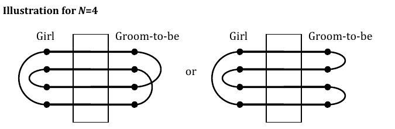

# Feladatleírások - 2010

## BatchSystemRoulette

#### Problem Statement (BatchSystemRoulette)

In the past, whole organizations depended on a single, big computer to do all the computational work. In a particular case, a computer has a list of pending jobs which is described by int\[\] duration and String\[\] user, each with n elements. duration\[i\] is the total time in minutes required to complete the i-th job and user\[i\] is a string that identifies the user that requested that job. A user may request multiple jobs. The computer may only process one job at a time. The waiting time for a user is defined as the time that this user has to wait before all of the jobs (s)he requested are finished. The computer will always pick a schedule to process the jobs in such a way that the average of waiting times over all users is minimized. If there are multiple schedules that can accomplish the minimum average waiting time, the computer will pick any of them with equal probability.

We need a way to estimate how long the computer will take to finish each of the jobs. Your method must return a double\[\] containing n elements. The i-th element of your return must be the expected time in minutes before the computer finishes processing the i-th job.

#### Definition

Class: BatchSystemRoulette

Method: expectedFinishTimes

Parameters: int\[\], String\[\]

Returns: double\[\]

Method signature: double\[\] expectedFinishTimes(int\[\] duration, String\[\] user)

(be sure your method is public)

#### Notes

- User names are case sensitive. A user named "Bob" is different from a user named "bob". See example 1 for clarification.

- Each element of the returned value must have an absolute or relative error less than 1e-9.

#### Constraints

- duration will contain between 1 and 50 elements, inclusive.

- user will contain the same number of elements as duration.

- Each element of duration will be between 1 and 1000000000, inclusive.

- Each element of user will contain between 1 and 50 characters, inclusive.

- Each element of user will contain only letters ('a'-'z','A'-'Z') and at most one space character that will not be a leading or trailing space.

#### Examples

0)

    {3, 2, 4, 1}

    {"Gil Grissom", "Sarah Sidle", "Warrick Brown", "Catherine Willows"}

    Returns: {6.0, 3.0, 10.0, 1.0 }

There is only one optimal way to schedule the jobs: {3, 1, 0, 2}.

1)

    {3, 2, 4, 1}

    {"mac taylor", "Mac Taylor", "Mac Taylor", "Peyton Driscoll"}

    Returns: {4.0, 8.0, 9.0, 1.0 }

This time, there are two different ways to schedule the jobs that are optimal: {3, 0, 1, 2} and {3, 0, 2, 1}.

2)

    {13, 14, 15, 56, 56}

    {"Tim Speedle", "Tim Speedle", "Tim Speedle", "Horatio Caine", "YEEEAAAAAAAAAAH"}

    Returns: {27.5, 28.0, 28.5, 126.0, 126.0 }

## PickingUpChicks

Problem (PickingUpChicks)

A flock of chickens are running east along a straight, narrow road. Each one is running with its own constant speed. Whenever a chick catches up to the one in front of it, it has to slow down and follow at the speed of the other chick. You are in a mobile crane behind the flock, chasing the chicks towards the barn at the end of the road. The arm of the crane allows you to pick up any chick momentarily, let the chick behind it pass underneath and place the picked up chick back down. This operation takes no time and can only be performed on a pair of chicks that are immediately next to each other, even if 3 or more chicks are in a row, one after the other.

Given the initial locations (Xi) at time 0 and natural speeds (Vi) of the chicks, as well as the location of the barn (B), what is the minimum number of swaps you need to perform with your crane in order to have at least K of the N chicks arrive at the barn no later than time T?

You may think of the chicks as points moving along a line. Even if 3 or more chicks are at the same location, next to each other, picking up one of them will only let one of the other two pass through. Any swap is instantaneous, which means that you may perform multiple swaps at the same time, but each one will count as a separate swap.

#### Input

The first line of the input gives the number of test cases, C. C test cases follow. Each test case starts with 4 integers on a line -- N, K, B and T. The next line contains the N different integers Xi, in increasing order. The line after that contains the N integers Vi. All distances are in meters; all speeds are in meters per second; all times are in seconds.

#### Output

For each test case, output one line containing "Case \#x: S", where x is the case number (starting from 1) and S is the smallest number of required swaps, or the word "IMPOSSIBLE".

#### Limits

$1 \le C \le 100;$
$1 \le B \le 1,000,000,000;$
$1 \le T \le 1,000;$
$0 \le Xi < B;$
$1 \le Vi \le 100;$
All the Xi's will be distinct and in increasing order.

#### Small dataset

$1 \le N \le 10;$
$0 \le K \le min(3, N);$

#### Large dataset

$1 \le N \le 50;$
$0 \le K \le N;$

#### Sample

##### Input

    3
    5 3 10 5
    0 2 5 6 7
    1 1 1 1 4
    5 3 10 5
    0 2 3 5 7
    2 1 1 1 4
    5 3 10 5
    0 2 3 4 7
    2 1 1 1 4

##### Output

    Case #1: 0
    Case #2: 2
    Case #3: IMPOSSIBLE

## BribeThePrisoners

Problem (Bribe the prisoners)

In a kingdom there are prison cells (numbered 1 to P) built to form a straight line segment. Cells number i and i+1 are adjacent, and prisoners in adjacent cells are called "neighbours." A wall with a window separates adjacent cells, and neighbours can communicate through that window.

All prisoners live in peace until a prisoner is released. When that happens, the released prisoner's neighbours find out, and each communicates this to his other neighbour. That prisoner passes it on to his other neighbour, and so on until they reach a prisoner with no other neighbour (because he is in cell 1, or in cell P, or the other adjacent cell is empty). A prisoner who discovers that another prisoner has been released will angrily break everything in his cell, unless he is bribed with a gold coin. So, after releasing a prisoner in cell A, all prisoners housed on either side of cell A - until cell 1, cell P or an empty cell - need to be bribed.

Assume that each prison cell is initially occupied by exactly one prisoner, and that only one prisoner can be released per day. Given the list of Q prisoners to be released in Q days, find the minimum total number of gold coins needed as bribes if the prisoners may be released in any order.

Note that each bribe only has an effect for one day. If a prisoner who was bribed yesterday hears about another released prisoner today, then he needs to be bribed again.

#### Input

The first line of input gives the number of cases, N. N test cases follow. Each case consists of 2 lines. The first line is formatted as

P Q

where P is the number of prison cells and Q is the number of prisoners to be released.

This will be followed by a line with Q distinct cell numbers (of the prisoners to be released), space separated, sorted in ascending order.

#### Output

For each test case, output one line in the format

Case \#X: C

where X is the case number, starting from 1, and C is the minimum number of gold coins needed as bribes.

#### Limits

$1 \le N \le 100$

$Q \le P$

Each cell number is between 1 and P, inclusive.

#### Small dataset

$1 \le P \le 100$

$1 \le Q \le 5$

#### Large dataset

$1 \le P \le 10000$

$1 \le Q \le 100$

#### Sample

##### Input

    2
    8 1
    3
    20 3
    3 6 14

##### Output

    Case #1: 7
    Case #2: 35

#### Note

In the second sample case, you first release the person in cell 14, then cell 6, then cell 3. The number of gold coins needed is 19 + 12 + 4 = 35. If you instead release the person in cell 6 first, the cost will be 19 + 4 + 13 = 36.

## NumberGame

#### Problem (Number Game)

Arya and Bran are playing a game. Initially, two positive integers A and B are written on a blackboard. The players take turns, starting with Arya. On his or her turn, a player can replace A with A - k\*B for any positive integer k, or replace B with B - k\*A for any positive integer k. The first person to make one of the numbers drop to zero or below loses.

For example, if the numbers are initially (12, 51), the game might progress as follows:

- Arya replaces 51 with 51 - 3\*12 = 15, leaving (12, 15) on the blackboard.

- Bran replaces 15 with 15 - 1\*12 = 3, leaving (12, 3) on the blackboard.

- Arya replaces 12 with 12 - 3\*3 = 3, leaving (3, 3) on the blackboard.

- Bran replaces one 3 with 3 - 1\*3 = 0, and loses.

We will say (A, B) is a winning position if Arya can always win a game that starts with (A, B) on the blackboard, no matter what Bran does.

Given four integers $A_{1}$, $A_{2}$, $B_{1}$, $B_{2}$, count how many winning positions (A, B) there are with $A_{1}$ ≤ A ≤ $A_{2}$ and $B_{1}$ ≤ B ≤ $B_{2}$.

#### Input

The first line of the input gives the number of test cases, T. T test cases follow, one per line. Each line contains the four integers $A_{1}$, $A_{2}$, $B_{1}$, $B_{2}$, separated by spaces.

#### Output

For each test case, output one line containing "Case \#x: y", where x is the case number (starting from 1), and y is the number of winning positions (A, B) with $A_{1}$ ≤ A ≤ $A_{2}$ and $B_{1}$ ≤ B ≤ $B_{2}$.

#### Limits

$1 \le T \le 100$.
$1 \le A_{1} \le A_{2} \le 1,000,000$.
$1 \le B_{1} \le B_{2} \le 1,000,000$.

#### Small dataset

$A_{2} - A_{1} \le 30$.
$B_{2} - B_{1} \le 30$.

#### Large dataset

$A_{2} - A_{1} \le 999,999$.
$B_{2} - B_{1} \le 999,999$.

No additional constraints.

#### Sample

##### Input

    3
    5 5 8 8
    11 11 2 2
    1 6 1 6

##### Output

    Case #1: 0
    Case #2: 1
    Case #3: 20

## QualificationRound

#### Problem Statement (QualificationRound)

#### Problem

You've just advanced from the Qualification Round of Google Code Jam Africa 2010, and you want to know how many of your fellow contestants advanced with you. To give yourself a challenge, you've decided only to look at how many people solved each problem.

The Qualification Round consisted of P problems; the $i^{th}$ problem was fully solved by Si contestants. Contestants had to solve C problems in order to advance to the next round. Your job is to figure out, using only that information, the maximum number of contestants who could have advanced.

#### Input

The first line of the input gives the number of test cases, T. T lines follow. Each will consist only of space-separated integers: first P, then C, then P integers S0...SP-1.

#### Output

For each test case, output one line containing "Case #x: y", where x is the case number (starting from 1) and y is the maximum number of contestants who could have advanced (in other words, the maximum number of contestants who could have solved at least C problems).

#### Limits

    1 ≤ T ≤ 100
    1 ≤ C ≤ P

##### Small dataset

    1 ≤ P ≤ 6
    0 ≤ Si ≤ 1000

##### Large dataset

$1 \le P \le 60$
$0 \le Si \le 10^{17}$

#### Sample

##### Input

    2
    2 2 73 100
    3 2 245 272 238

##### Output

    Case #1: 73
    Case #2: 377

## TheNextNumber

#### Problem Statement (TheNextNumber)

You are writing out a list of numbers. Your list contains all numbers with exactly Di digits in its decimal representation which are equal to i, for each i between 1 and 9, inclusive. You are writing them out in ascending order.

For example, you might be writing every number with two '1's and one '5'. Your list would begin 115, 151, 511, 1015, 1051.

Given N, the last number you wrote, compute what the next number in the list will be.

#### Input

The first line of input contains an integer T, the number of test cases in the input. T lines follow, one for each test case, each containing a single integer N.

#### Output

    For each test case, output

	Case #X: K

where X is the test case number, starting from 1, and K is the next integer in the list.

#### Limits

#### Small dataset

$1 \le T \le 50$
$1 \le N \le 10^{6}$

#### Large dataset

$1 \le T \le 500$
$1 \le N \le 10^{20}$

#### Sample

##### Input

    3
    115
    1051
    6233

##### Output

    Case #1: 151
    Case #2: 1105
    Case #3: 6323

## TicketPrinters

#### Problem Statement (TicketPrinters)

After 2 years of hard work, it is finally time to unveil the ultimate plan to win the lottery. This plan involves mostly cartomancy, falsification and programming. The tarot specialist has already predicted the N numbers of the required lottery tickets, and they are given as a int\[\] wantedValues. The falsification specialist has prepared a set of N ticket printers and he has taken a number of security measures to make it very hard to discover the scheme:

- The printers are in separate locations. For convenience, they are all hidden inside houses that are all on a single street. The distances between each consecutive pair of printers are given by int\[\] printerDistance, which contains (n-1) elements. For each i, the time required to travel between printer i and printer i+1 is printerDistance\[i\] seconds.

The way a printer functions is by keeping a hidden integer number in its memory. For security, increasing or decreasing the number by one requires 1 second. At any time, it is possible to order the printer to print the number it has in memory. This procedure also takes 1 second. The starting number for printer i is startingValues\[i\]

- Each printer can print at most one ticket.

Your role as the programmer is to go to each printer and print the required lottery tickets given by wantedValues. You are currently in the same location as printer number currentPrinter. Since you do not understand why they even hired a programmer for the scheme, you have decided to use programs to save time in this process. The first program you have developed can, given a wanted number, modify the one in the printer by automatically increasing or decreasing it and finally print the wanted number automatically (increasing/decreasing the numbers and printing them still requires one second). You can install this program to each printer once you are its location. The installation doesn't take any time. Once the program is installed, it can work without any administration from your side, so you can immediately proceed to the next printer.

Now your task is to develop the second program that should determine in which order to visit printers and which printer to use for printing of each of the tickets. Return the outcome of the second program, i.e., the minimum time that is necessary to finish printing all the required numbers.

#### Definition

Class: TicketPrinters

Method: minTime

Parameters: int, int\[\], int\[\], int\[\]

Returns: int

Method signature: int minTime(int currentPrinter, int\[\] printerDistance, int\[\] startingValues, int\[\] wantedValues)

(be sure your method is public)

#### Constraints

- wantedValues will contain between 1 and 16 elements, inclusive.

- startingValues will contain n elements, where n is the number of elements in wantedValues.

- printerDistance will contain exactly n-1 elements.

- currentPrinter will be between 0 and n-1, inclusive.

- Each element of startingValues, printerDistance and wantedValues will be between 1 and 1000000, inclusive.

- Each element of wantedValues will be unique.

#### Examples

0)

    0

    {100, 20, 50}

    {66, 78, 99, 5}

    {99, 5, 78, 66}

    Returns: 171

1)

    1

    {50, 50}

    {100, 200, 300}

    {101, 201, 302}

    Returns: 152

A possible way to print the tickets is:

0 seconds: Start printing program up at printer 1 to print ticket \#201. Begin moving to printer 2's position.
1 second: Printer 1 reaches number 201 in memory.
2 seconds: Printer 1 finishes printing its assigned ticket.
50 seconds: Arrive at printer 2's location. Order it to print ticket \#302. Begin moving to printer 0's position.
52 seconds: Printer 2 reaches number 302 in memory.
53 seconds: Printer 2 finishes printing its assigned ticket.
150 seconds: Arrive at printer 0's location. Order it to print ticket \#101.
151 seconds: Printer \#0 reaches number \#101 in memory.
152 seconds: Printer \#0 finishes printing ticket \#101.

2)

    2

    {13, 26, 39, 13}

    {123, 12, 32, 67, 1015}

    {1, 2, 3, 4, 5}

    Returns: 1063

## HotDog

A number of hot dog vendors have started selling hot dogs at corners (intersections) along a very long east-west street. The problem is that multiple vendors might be selling at the same corner, and then they will take each other's business. All is not lost though! The hot dog vendors have a plan.

If there are ever two or more vendors at the same corner, then exactly two of the vendors can perform a move, which means:

- One vendor moves one corner further to the east along the street.

- The other vendor moves one corner further to the west along the street.

Remember that the street is really long, so there is no danger of running out of corners. Given the starting positions of all hot dog vendors, you should find the minimum number of moves they need to perform before the vendors are all separated (meaning they are all on different corners).

For example, suppose the street begins with the following number of hot dog vendors on each corner, listed in order from west to east:

    ... 0 0 2 1 2 0 0 ...

Then the vendors can be separated in three moves, as shown below:

    ... 0 0 2 1 2 0 0 ...

        \|

        +--- Do a move here

    ... 0 1 0 2 2 0 0 ...

          \|

          +--- Do a move here

    ... 0 1 1 0 3 0 0 ...

            \|

            +--- Do a move here

    ... 0 1 1 1 1 1 0 ...

#### Input

Each street corner is labeled with an integer, positive or negative. For each i, corner i+1 refers to the next corner to the east from corner i. We will use this labeling system to describe corners in the input file.

The first line of the input file contains the number of cases, T. T test cases follow. Each case begins with the number of corners C that have at least one hot dog vendor in the starting configuration. The next C lines each contain a pair of space-separated integers P, V, indicating that there are V vendors at corner P.

#### Output

For each test case, output one line containing "Case \#x: M", where x is the case number (starting from 1) and M is the minimum number of moves that need to be performed before the vendors all end up at different corners from each other.

#### Limits

$1 \le T \le 50$.
$1 \le C \le 200$.
All P values are in the range \[-1000000, 1000000\].
Within each test case, all P values are distinct and listed in increasing order.
All V values are positive integers. The limit on the sum of all V values is listed below.
It will always be possible to separate the hot dog vendors in a finite number of moves.

#### Small dataset

The total number of hot dog vendors in each test case is at most 200.

#### Large dataset

The total number of hot dog vendors in each test case is at most 100000.

#### Sample

##### Input

    2
    3
    -1 2
    0 1
    1 2
    2
    -1000 1
    2000 1

##### Output

    Case #1: 3
    Case #2: 0

## Sheep

#### Problem Statement (Sheep)

After a long bout of sleeplessness, Elleonara has finally fallen asleep. To accomplish this, she had to count sheep until the number overflowed and became negative. She is now in the middle of a strange dream. She is on the bank of a river with a flock of numSheep sheep, and across the river are endless grass fields. She wants to take all her sheep across the river to the fields using a single boat. Elly wonders what the minimum weight capacity of the boat must be for her to accomplish this by making at most maxRuns runs. Crossing the river to the fields and then coming back again counts as a single run.

Her sheep are of varying weights. She decides to use the following greedy strategy to determine the order in which to take them. In each run, she first chooses the heaviest remaining sheep that can fit in the boat. Then, after putting that sheep in the boat, she again chooses the heaviest remaining sheep that can fit in the boat along with the previously chosen sheep. She repeats this process until no other sheep can fit in the boat. She then takes the boat to the other side, drops off the sheep, and comes back. For example, if the boat's capacity is 42 and the sheep have weights of 30, 15, 13, 8, 5, 3, 2 and 2, she would pick the sheep with weights 30, 8 and 3. If after maxRuns runs, there are still sheep remaining on the bank, this means the capacity of the boat is not high enough.

You are given String\[\]s part1, part2, part3 and part4. Concatenate the elements in each String\[\] in the same order as they are given without any delimiters between its elements to get four long strings. Then, concatenate those strings to get a space separated list of integers. Each integer is the weight of one sheep in her flock. Return the minimum weight capacity of a boat that will accomplish Elly's goal.

#### Definition

Class: Sheep

Method: minCapacity

Parameters: int, int, String\[\], String\[\], String\[\], String\[\]

Returns: int

Method signature: int minCapacity(int numSheep, int maxRuns, String\[\] part1, String\[\] part2, String\[\] part3, String\[\] part4)

(be sure your method is public)

#### Notes

- Elly's weight is a constant and can be ignored.

- Although her strategy of matching sheep into the boat is not always optimal, she will use it anyway.

- The capacity of the boat should be at least as much as the largest sheep (otherwise it couldn't be moved on any run) and no more than the sum of the weights of all sheep (which guarantees that they can be moved on the first run).

#### Constraints

- numSheep will be between 1 and 2,000, inclusive

- maxRuns will be between 1 and 2,000, inclusive

- part1, part2, part3 and part4 will each contain between 0 and 50 elements, inclusive

- Each element of part1, part2, part3 and part4 will contain between 1 and 50 characters, inclusive.

- After concatenating the elements of part1-part4, and then concatening those strings, the final string will be a single space separated list of integers.

- There will be exactly numSheep integers in the list.

- Each integer in the list will be between 1 and 2,000, inclusive.

- Integers in the list will have no leading zeros.

#### Examples

0.)

6

2

    { "26 7 10 30 5 4" } { } { } { }

Returns: 42

The capacity of the boat should be at least 30, but this is not enough for all sheep to be taken with only 2 runs. Indeed, in this case Elleonora would need three runs - first, she would transfer the sheep with weight 30, then the sheep with weights 26 and 4 and finally the sheep with weights 10, 7 and 5. The smallest capacity that satisfies Elleonora is 42 - the first run will be (30, 10) and the second will be (26, 7, 5, 4). Note that there exists a strategy where the boat of size 41 is enough - the runs are (30, 7, 4) and (26, 10, 5), but Elly will not use it.

1.)

6

2

    { "4 8 15 16 23 42" } { } { } { }

Returns: 54

With capacity 54 the runs are (42, 8, 4) and (23, 16, 15). Since in both of them the boat is completely filled, this guarantees that the answer is optimal.

2.)

15

4

    { "666 42 7 13 400 511 600 200 202 111 313 94 280", " 72 42" } { } { } { }

Returns: 896

We can have equal numbers in the input.

## Bribes

#### Problem Statement (Bribes)

The Government in Bulgaria is elected every four years. When an election is held, most people don't vote. They then complain about the new government for the entire time they're in charge, but when the next elections are held four years later, they again don't vote.

Elleonora plans to use this low voter turnout to her advantage. She has found the key to the prime minister's chair: bribes. To ensure that she will win the election, she has decided to bribe all people, who show up on the day of elections, into voting for her. Due to the so called "shurobadjanashtina" (a Bulgarian term meaning that each person is related in some way to all other people), she doesn't even need to pay every voter. For example, if a young couple shows up to vote, bribing just one of them might be sufficient since the other will voluntarily vote for the same candidate.

All voters are lined up in front of the voting place. They are numbered 0 to N-1 from left to right. Each voter has two integer attributes - influence and resistance. They are given in int\[\]s influence and resistance, the i-th elements of which are the influence and resistance, respectively, of the i-th voter. Influence is a measure of how much a person can affect the decisions of the people surrounding him. Resistance is a measure of a person's will to vote for different candidate. If a person's resistance ever falls to zero or less, he will vote for Elleonora. If Elly bribes the i-th person in line, that person's resistance will be reduced by influence\[i\]. Since that person affects the people around him, the resistances of the person directly to his left and the person directly to his right (the (i-1)-th and (i+1)-th person, respectively) will each be reduced by influence\[i\]/2. All division in this problem is integer division, meaning that any fractional parts are discarded. The resistances of the (i-2)-th and (i+2)-th people will be reduced by influence\[i\]/4, and so on. More formally, when the i-th person is bribed, the resistance of the j-th person is reduced by influence\[i\]/2^(abs(i-j)), where abs(i-j) is the absolute value of i-j. If, after a number of bribes, everybody's resistance is less than or equal to zero, she has won all the votes, and therefore the election.

Return the minimum number of people she must bribe to win the election. She can't bribe the same person more than once. To win the election, every single person must vote for her. If this is impossible, return -1 instead.

#### Definition

Class: Bribes

Method: minBribes

Parameters: int\[\], int\[\]

Returns: int

Method signature: int minBribes(int\[\] influence, int\[\] resistance)

(be sure your method is public)

#### Constraints

- influence and resistance will each contain between 1 and 50 elements, inclusive.

- influence and resistance will contain the same number of elements.

- Each element of influence and resistance will be between 1 and 500, inclusive.

#### Examples

0)

    { 10, 3, 5, 3, 1 }

    { 11, 2, 7, 3, 1 }

    Returns: 2

The influence can be less than, equal or greater than the resistance of a given person. Here the optimal strategy is to bribe the people with indices 0 and 2, decreasing the resistances of the people by {10, 5, 2, 1, 0} and {1, 2, 5, 2, 1}, respectively, making the final resistances {0, -5, 0, 0, 0}.

1)

    { 15, 15, 15 }

    { 13, 42, 13 }

    Returns: -1

This one is impossible. Even when bribing all of them, the final resistance is {-12, 13, -12}. The cake is a lie.

2)

    { 10, 16, 4, 7, 1, 1, 13 }

    { 10, 16, 4, 7, 1, 1, 13 }

    Returns: 4

After bribing the people with influence 16, 13, and 10, only one person remains with barely positive resistance. She still has to bribe that one person to have full support and win the election.

3)

    { 479, 340, 398, 40, 477, 181, 422, 377, 60, 486, 15, 500, 307, 1, 2, 65,
    411, 374, 446, 401 }

    { 402, 87, 20, 76, 468, 493, 252, 98, 216, 58, 89, 500, 89, 26, 8, 125, 269,
    116, 426, 81 }

    Returns: 7

## Knots

Problem (Knots – 3582)

An even number N of strands are stuck through a wall. On one side of the wall, a girl ties N/2 knots between disjoint pairs of strands. On the other side of the wall, the girl's groom-to-be also ties N/2 knots between disjoint pairs of strands. You are to find the probability that the knotted strands form one big loop (in which case the couple will be allowed to marry). See illustration!

For example, suppose that N = 4 and you number the strands 1, 2, 3, 4. Also suppose that the girl has created the following pairs of strands by tying knots: {(1, 4), (2,3)}. Then the groom-to-be has two choices for tying the knots on his side: {(1,2), {3,4)} or {(1,3), (2,4)}.

#### Input

The input file consists of one or more lines. Each line of the input file contains a positive even integer, less than or equal to 100. This integer represents the number of strands in the wall.

#### Output

For each line of input, the program will produce exactly one line of output: the probability that the knotted strands form one big loop, given the number of strands on the corresponding line of input. Print the probability to 5 decimal places.

#### Limits

$2 < N \le 100$

#### Sample

##### Input

    4
    20

##### Output

    0.66667
    0.28377



#### Megoldás

```cpp
#include <cstdio>
using namespace std;
int main()
{
    int N;
    while(scanf("%d",&N) == 1)
    {
        double r; // Ebbe írd az eredményt...
        // ...hogy itt kiíródjon az értéke:
        printf("%.5lf\n",r);
    }
    return 0;
}
```
