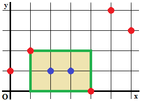
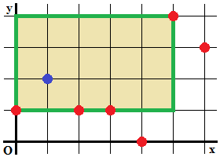

# Feladatleírások - 2011

## PartyTime

Problem 3: Party Time

You're throwing a party for your friends, but since your friends may not all know each other, you're afraid a few of them may not enjoy your party. So to avoid this situation, you decide that you'll also invite some friends of your friends. But who should you invite to throw a great party?

Luckily, you are in possession of data about all the friendships of your friends and their friends. In graph theory terminology, you have a subset  of the social graph, whose vertices correspond to your friends and their friends (excluding yourself), and edges in this graph denote mutual friendships.  Furthermore, you have managed to obtain exact estimates of how much food each person in  will consume during the party if he were to be invited.

You want to choose a set of guests from . This set of guests should include all your friends, and the subgraph of  formed by the guests must be connected. You believe that this will ensure that all of your friends will enjoy your party since any two of them will have something to talk about...

In order to save money, you want to pick the set of guests so that the total amount of food needed is as small as possible. If there are several ways of doing this, you prefer one with the fewest number of guests.

The people/vertices in your subset  of the social graph are numbered from 0 to  - 1. Also, for convenience your friends are numbered from 0 to  - 1, where  is the number of your friends that you want to invite. You may also assume that  is connected. Note again that you are not yourself represented in .

#### Input

The first line of the input consists of a single number , the number of test cases. Each test case starts with a line containing three integers , the number of nodes in , , the number of friends, and , the number of edges in . This is followed by  lines each containing two integers. The $^{th}$ of these lines will contain two distinct integers  and  which indicates a mutual friendship between person  and person . After this follows a single line containing  space-separated integers with $the^{th}$ representing the amount of food consumed by person .

#### Output

Output  lines, with the answer to each test case on a single line by itself. Each line should contain two numbers, the first being the minimum total quantity of food consumed at a party satisfying the given criteria and the second the minimum number of people you can have at such a party.

#### Constraints

= 50

$1 \le  \le 11$

$\le -1$

$2 \le  \le 250$

$-1 \le  \le  * ( - 1) / 2$

is connected, and contains no self-loops or duplicate edges.

For each person, the amount of food consumed is an integer between 0 and 1000, both inclusive.

## CollectingPostmarks

Problem Statement (CollectingPostmarks)

Your hobby is collecting postmarks. There is a total of N distinct postmarks, numbered from 0 to N-1. Their prices are given in the int[] prices, where the i-th element (0-indexed) is the price of postmark i. The price of a postmark is the amount of money you would get for selling it, and the amount of money it would cost you to buy it. The values of the postmarks are given in the int[] values, where the i-th element (0-indexed) is the value of postmark i. Only one of each postmark exists.

The postmarks you currently have are given in the int[] have. Your goal is to have a postmark collection with a total value of at least K. You can sell postmarks to get money to buy different postmarks. Initially, you have no money. Return the minimum additional amount of money you need to achieve your goal, or -1 if it is impossible.

#### Definition

Class: CollectingPostmarks

Method: amountOfMoney

Parameters: int[], int[], int[], int

Returns: int

Method signature: int amountOfMoney(int[] prices, int[] have, int[] values, int K)

(be sure your method is public)

#### Constraints

-N will be between 1 and 32, inclusive.

-K will be between 0 and 1,000,000,000, inclusive.

-prices will contain exactly N elements.

-Each element of prices will be between 1 and 30,000,000, inclusive.

-values will contain exactly N elements.

-Each element of values will be between 1 and 30,000,000, inclusive.

-have will contain between 0 and N elements, inclusive.

-All elements of have will be distinct.

-Each element of have will be between 0 and N-1, inclusive.

#### Examples

0)

    {2,15}

    {}

    {2,21}

    13

You initially have no postmarks. You need 15 units of money to buy postmark 1, which has a value of 21.

1)

```text
{9,18,7,6,18}

{4,0}

{12,27,10,10,25}

67
```

    Returns: 22

2)

{14,14,12,6}

    {3,2,1}

    {19,23,20,7}

    10

You already have enough postmarks.

3)

    {43,33,14,31,42,37,17,42,40,20}

    {6}

    {116,71,38,77,87,106,48,107,91,41}

    811

The total value of all available postmarks is less than 811.

## ShipLoading

Problem Statement (ShipLoading)

You have to load a ship with some cargo. All the cargo is put in boxes. There are some cranes and each of them can put one box in the ship per minute. All cranes can work simultaneously. Each crane has a weight limit - it cannot move a box whose weight is greater than that limit. Return the minimal time (measured in minutes) needed to load the ship with all cargo or -1 if it is impossible.

You are given a int[] cranes, the i-th element of which is the weight limit of the i-th crane. You are also given a String[] boxes. Concatenate the elements of boxes to get a space-separated list of the boxes' weights.

#### Definition

Class: ShipLoading

Method: minimumTime

Parameters: int[], String[]

Returns: int

Method signature: int minimumTime(int[] cranes, String[] boxes)

(be sure your method is public)

#### Constraints

-cranes will contain between 1 and 50 elements, inclusive.

-boxes will contain between 1 and 50 elements, inclusive.

-Each element of boxes will contain between 0 and 50 characters, inclusive. -The concatenation of all elements of boxes will be a non-empty space-separated list of integers with no leading zeroes. It will contain no leading, trailing, or consecutive spaces.

-Each element of cranes will be between 1 and 1,000,000, inclusive.

-Each box weight will be between 1 and 1,000,000, inclusive.

#### Examples

0)

    {6,8,9}

    {"2 5 2 4 7"}

Everything can be done in 2 minutes.

1)

    {19,20}

    {"14 12 16 19 16 1 5"}

Only two cranes, but each of them can move any of the boxes.

2)

```text
{23,32,25,28}

{"5 27 10 16 24 20 2 32 18 7"}
```

    Returns: 3

3)

```text
{11,17,5,2,20,7,5,5,20,7}

{"18 18 15 15 17"}
```

    Returns: 2

4)

```text
{56,114,979,120,120,87,480}

{"221 882 504 358 642 674 212 679 203 279 632 799 79","6 502 275 823 372 594 482 343"}
```

    Returns: 12

## WalkingDistance

Problem Statement (WalkingDistance)

A map of the city consists of a number of streets connecting several junctions. All the streets are straight line segments connecting two junctions, organized in such a way that starting at any junction and walking along the streets one can reach any other junction. The walking distance between two points (each either a junction or some intermediate point of a street) in the city is the shortest path from the first point to the second, if you are allowed to walk only along the streets. The length of the street is the Cartesian distance between its ends. Streets never intersect outside the junctions. Tunnels and overpasses are used whenever necessary to achieve this (see example 1 for further clarification).

Given a map of the city, your goal is to find the maximal walking distance among any two points in the city. The map of the city is provided as follows. You are given two int\[\]s x and y, each of the same length N. These two int\[\]s represent N junctions with Cartesian coordinates (x\[i\], y\[i\]) for i = 0..N-1. You are also given a String\[\] streets, where the j-th element of streets\[i\] is 'Y' if the junctions i and j are connected by a street, and 'N' otherwise.

#### Definition

Class: WalkingDistance

Method: getLongestShortest

Parameters: int\[\], int\[\], String\[\]

Returns: double

Method signature: double getLongestShortest(int\[\] x, int\[\] y, String\[\] streets)

(be sure your method is public)

#### Notes

-Your return value must have an absolute or relative error less than 1e-9.

#### Constraints

\-x and y and streets will each contain between 2 and 50 elements, inclusive.-x, y and streets will have the same number of elements.-Each element of x and y will be between -1000 and 1000, inclusive.-Each element of streets will contain exactly n characters, where n is the number of elements in streets.-Each element of streets will contain only 'N' and 'Y' characters.-The i-th character of the i-th element of streets will always be 'N'.-The i-th character of the j-th element of streets will always be equal to the j-th character of the i-th element of streets.-All junctions represented by x and y will be distinct.-There will be a path between every pair of junctions.

#### Examples

0)

{0,1}

    {0,1}

    {"NY","YN"}

There are just two junctions conntected by a road. So the answer is the length of the street, which is the square root of 2.

1)

    {0,2,2,0}

    {0,0,2,2}

    {"NNYY","NNYY","YYNN","YYNN"}

Both points on which this maximal shortest distance is achieved have coordinates (1, 1), but they are located on different streets.

2)

    {0,1,0}

    {0,0,1}

    {"NYY","YNY", "YYN"}

The three junctions form a right isosceles triangle. Two points for which the maximal walking distance is achieved are (0,0) and (1/2, 1/2).

3)

```text
{0, 1, 2}

{0, 1, 2}

{"NYY", "YNN", "YNN"}
```

    Returns: 4.242640687119286

## InfiniteAddition

Problem Statement (InfiniteAddition)

An infinite periodic string is a string consisting of a non-periodic string S repeated infinitely, and is denoted as (S). For example, (ABC)=ABCABCABCA... Note that S must not be a repetition itself, so (ABAB)=ABABABAB... is not legal, and should be written as (AB)=ABABABAB... instead. S must contain only uppercase letters ('A'-'Z').

The sum of two infinite periodic strings is the string where each character is the sum of the corresponding characters in the two strings. Two characters are added as follows. Adding A to a character means changing it to the next character in the alphabet (where A is the next character after Z): A+A=B, A+B=C, A+C=D, ..., A+Y=Z, A+Z=A. Adding B to a character means changing it to the next character twice: B+A=C, B+B=D, B+C=E, ..., B+Z=B. All the other characters behave in the same manner (C means changing to the next character 3 times, D means 4, ..., Z means 26, so adding Z doesn't change a character).

The sum of two infinite periodic strings is itself an infinite periodic string. For example, (YAAZZB)=(AB)+(XYZ).

Given three integers, sum, op1 and op2, return an example of such an addition formatted as "(S)=(P)+(Q)" (quotes for clarity only), where S contains exactly sum characters, P contains exactly op1 characters, and Q contains exactly op2 characters. Remember that S, P and Q each need to be non-periodic.

If there are several possible answers, return the one among them where S comes earliest alphabetically. If there is a tie, return the answer among the ties where P comes earliest alphabetically. If there is no solution, return "NO SOLUTION" (quotes for clarity only).

#### Definition

Class: InfiniteAddition

Method: giveExample

Parameters: int, int, int

Returns: String

Method signature: String giveExample(int sum, int op1, int op2)

(be sure your method is public)

#### Constraints

\-sum, op1 and op2 will each be between 1 and 20, inclusive.

#### Examples

0)

6

    2

    3

The more 'A's you have in the beginning, the better. However, you can't make it just "(AAAAAA)=(AA)+(ZZZ)", as the strings inside parentheses need to be non-periodic.

1)

    10

    5

    5

No matter what the added strings are, the period of the sum can't be more than 5 in this case.

2)

    5

    5

    5

3)

```text
1

5

5
```

    Returns: "(A)=(AAAAB)+(ZZZZY)"

## RaceOrdering

Problem Statement (RaceOrdering)

You are trying to predict the outcome of a race between n runners, numbered from 0 to n - 1.You are given two int\[\]s, first and second. It is guaranteed that for all i, the runner numbered first\[i\] will always beat the runner numbered second\[i\]. Determine how many final orderings are possible, modulo 1,000,003. If the information is contradictionary, return 0. Runners are never tied.

#### Definition

Class: RaceOrdering

Method: countOrders

Parameters: int, int\[\], int\[\]

Returns: int

Method signature: int countOrders(int n, int\[\] first, int\[\] second)

(be sure your method is public)

#### Constraints

\-n will be between 1 and 30, inclusive.-first and second will each contain between 0 and 15 elements, inclusive.-first and second will contain the same number of elements.-Each element of first and second will be between 0 and n - 1, inclusive.-first\[i\] does not equal second\[i\] for all i between 0 and m - 1, inclusive, where m is the number of elements in first and second.

#### Examples

0)

3

    {1}

    {2}

Contestant 1 beat contestant 2, so the valid orders are 012, 102 and 120.

1)

    4

    {0, 0}

    {1, 2}

Contestant 0 beat contestants 1 and 2, but there is no information on contestant 3. The valid orderings are 3012, 3021, 0312, 0321, 0132, 0231, 0123 and 0213.

2)

    10

    {1, 2, 3}

    {2, 3, 1}

There is no way to satisfy this cycle.

3)

```text
30

{}

{}
```

    Returns: 90317

## HamiltonPath

Problem Statement (HamiltonPath)

There are N cities in a country, numbered 0 to N-1. Each pair of cities is connected by a bidirectional road.

John plans to travel through the country using the following rules:

- He must start in one city and end in another city after travelling exactly N-1 roads.

- He must visit each city exactly once.

- You are given a String\[\] roads. If the j-th character of the i-th element of roads is 'Y', he must travel the road that connects city i and city j.

For example, if there are three cities, and he wants to travel the road between city 0 and city 1, there are 4 possible paths: 0-\>1-\>2, 1-\>0-\>2, 2-\>0-\>1, 2-\>1-\>0. Paths 0-\>2-\>1 and 1-\>2-\>0 are not allowed because they do not allow him to travel the road between city 0 and city 1.

Return the number of paths he can choose, modulo 1,000,000,007.

#### Definition

Class: HamiltonPath

Method: countPaths

Parameters: String\[\]

Returns: int

Method signature: int countPaths(String\[\] roads)

(be sure your method is public)

#### Constraints

\-roads will contain between 2 and 50 elements, inclusive.-Each element of roads will contain n characters, where n is the number of elements in roads.-Each character in roads will be 'Y' or 'N'.-The i-th character in the i-th element of roads will be 'N'.-The j-th character in the i-th element of roads and the i-th character in the j-th element of roads will be equal.

#### Examples

0)

{"NYN",

     "YNN",

     "NNN"}

The example from the problem statement.

1)

    {"NYYY",

     "YNNN",

     "YNNN",

     "YNNN"}

It's impossible to travel all these roads while obeying the other rules.

2)

    {"NYY",

     "YNY",

     "YYN"}

This is also impossible.

3)

```text
{"NNNNNY",

 "NNNNYN",

 "NNNNYN",

 "NNNNNN",

 "NYYNNN",

 "YNNNNN"}
```

    Returns: 24

## NumberGraph

Problem Statement (NumberGraph)

Two integers X and Y are joined by a positive integer P if the magnitude of their difference \|X-Y\| = P. X and Y are joined by a set of integers if they are joined by one of the numbers in that set. You are given a set of positive integers joiningSet, with the property that the number of trailing zeros in the binary representation of each integer in joiningSet is the same. You are also given a set of integers in a String\[\] graphSet. Concatenate the elements of graphSet to obtain a space-separated list of these integers. Consider the graph G with an edge joining each pair of numbers in graphSet that is joined by joiningSet. Determine the size of the largest subgraph of G, such that no pair of vertices in the subgraph is separated by a distance greater than 2.

#### Definition

Class: NumberGraph

Method: largestSet

Parameters: String\[\], int\[\]

Returns: int

Method signature: int largestSet(String\[\] graphSet, int\[\] joiningSet)

(be sure your method is public)

#### Notes

-In this problem, the size of a graph is equal to the number of vertices it contains.-The distance between two vertices is the length of the shortest path joining them, and can be considered infinite if the vertices are not connected.-The distance is measured within the taken subgraph, not within the whole graph.

#### Constraints

\-graphSet and joiningSet will each contain between 1 and 50 elements, inclusive.-Each element of joiningSet will be between 1 and 1000000 (10^6), inclusive.-Each element of graphSet will contain between 1 and 50 characters, inclusive.-The concatenation of the elements of graphSet will be a single-space-delimited list of integers, formatted without extra leading zeros.-graphSet will contain between 1 and 80 integers, inclusive.-Each integer in graphSet will be between 0 and 1000000 (10^6), inclusive.-The integers within each of graphSet and joiningSet will be distinct.-The lowest set bit in the binary representation of each element of joiningSet will be the same.

#### Examples

0)

{"1 2 3 4 6 9 13 15 16 18 21 26"}

    {2,6,10}

The subgraph induced by {3,9,13,15} is optimal in this case. 3 and 15 are both joined to 9 and 13, so any distance in this subgraph is no greater than 2.

1)

    {"4 11 12 10 9 6 2 7 1 8 5"}

    {3,5,1,7}

The subgraph induced by {4, 12, 10, 9, 6, 2, 7, 8, 5} is optimal here.

2)

    {"100 260 164 244 84 340 52 2"

    ,"12 388 4 308 180 228 484"}

    {16,176,208,48,240,80}

The number "212" has been separated into two parts "2" and "12". Make sure you concatenate the Strings before splitting into numbers.

3)

    {"10 6 130 162 164 39 73 27 72 167 41"}

    {3,63,95,123,57,91,35,137

    ,135,125,33,121,17,5,31

    ,45,67,29,157}

4)

    {"2136 2108 876 8"

    ,"6 348 8 1784 1146 1596 608 446 14"

    ,"64"

    ," 344 1452 1938 692 376 1482 860 1870"}

    {644,844,348,604,1260,516,868,2100,260

    ,1492,316,1076,268,852,12,1500,4,772

    ,1108,188,1444,1764,84,1732,532,332

    ,1588,500,700,1116,252,1060,68,1092

    ,724,132,484,340,684,1276,28,1788,588}

5)

    {"1000000"}

    {1}

6)

```text
{"1 2 3 4 5 6 7 8"}

{1}
```

    Returns: 3

## PeopleYouMayKnow

Problem Statement (PeopleYouMayKnow)

Tim wants to improve "People You May Know" feature of Facebook. This is a feature that attempts to automatically connect people who may know each other in reality, but haven't yet added each other as friends on Facebook.

Friendship on Facebook is symmetric, meaning that if B is a friend of A, then A is also a friend of B. However, it is not necessarily transitive, so if A and B are friends and B and C are friends, then A and C are not necessarily friends.

Tim has defined the term "n-friends" as follows. If two people are friends, they are called 1-friends. For n \>= 1, two people A and B are called (n+1)-friends if A and B are n-friends, or if there exists a person C such that A and C are n-friends and C and B are friends.

To determine how likely it is that two people know each other, Tim has introduced the concept of a "Distance Score". If two people A and B are not friends, then their Distance Score is the fewest number of people (other than A and B themselves) who must be removed from the network in order for A and B to not be 3-friends. The higher the Distance Score, the more likely it is that A and B know each other.

You are given String\[\] friends containing exactly N elements, where N is the number of people in the network. People are numbered from 0 to N-1. The j-th character of the i-th element of friends is 'Y' if i and j are friends, and 'N' otherwise. Return the Distance Score for person1 and person2.

#### Definition

Class: PeopleYouMayKnow

Method: maximalScore

Parameters: String\[\], int, int

Returns: int

Method signature: int maximalScore(String\[\] friends, int person1, int person2)

(be sure your method is public)

#### Constraints

\-friends will contain N elements, where N is between 2 and 40, inclusive.

-Each element of friends will contain exactly N characters.

-Each character in friends will be 'Y' or 'N'.

-For all i and j, friends\[i\]\[j\] will be equal to friends\[j\]\[i\].

-For all i, friends\[i\]\[i\] will be equal to 'N'.

-person1 and person2 will each be between 0 and N-1, inclusive.

-person1 and person2 will not be equal.

-friends\[person1\]\[person2\] will be equal to 'N'.

#### Examples

0)

{"NN"

    ,"NN"}

    0

    1

You don't need to remove any people.

1)

    {"NYNN"

    ,"YNYN"

    ,"NYNY"

    ,"NNYN"}

    0

    3

You need to remove person 1 or person 2.

2)

    {"NYNYYYN"

    ,"YNYNNYY"

    ,"NYNNNNY"

    ,"YNNNNNN"

    ,"YNNNNYN"

    ,"YYNNYNY"

    ,"NYYNNYN"}

    2

    3

You need to remove person 0 or person 1.

## MergingGraph

Problem Statement (MergingGraph)

You are given a directed graph. The graph may contain loops, and multiple edges may exist between pairs of vertices. You can merge a pair of vertices into a single vertex. When a pair of vertices is merged, outgoing and incoming edges from both vertices become outgoing and incoming edges, respectively, of the resulting vertex. For example, consider a graph with four vertices {a, b, c, d} and three edges {a->b, c->b, c->d}. If we merge vertices b and c, the resulting graph will have three vertices {a, bc, d} and three edges {a->bc, bc->bc, bc->d}.

A graph is a cycle if its vertices can be ordered v0, v1, ..., vn-1 (where n is the total number of vertices) such that the following two properties are satisfied:

- Every edge in the graph goes from vi to v(i+1)%n.

- For all i between 0 and n-1, inclusive, there exists at least one edge that goes from vi to v(i+1)%n.

You are given a String[] adj. The ith element of adj is a space delimited list of integers representing all the outgoing edges from vertex i. Each integer represents the target vertex of an outgoing edge. Return the minimal number of merge operations necessary to convert the given graph into a cycle. If a solution doesn't exist, return the number of vertices in the given graph instead.

#### Definition

Class: MergingGraph

Method: distanceToCycle

Parameters: String[]

Returns: int

Method signature: int distanceToCycle(String[] adj)

(be sure your method is public)

#### Constraints

-adj will contain between 1 and 50 elements, inclusive.-Each element of adj will contain between 0 and 50 characters, inclusive.-Each element of adj will be a single space separated list of integers.-Each number in each element of adj will be between 0 and (n - 1) inclusive, where n is the number of elements in adj.-Each number in each element of adj will contain no leading zeroes.

#### Examples

0)

    {"1 1", "2", "0 0 0"}

This graph is already a cycle.

1)

    {"0 1 1", "2", "0 0 0"}

The resulting cycle is a loop.

2)

    {"1", "", "3", ""}

The resulting cycle has 2 vertices.

3)

```text
{"2", "5 4", "", "0", "0", "0 0"}
```

    Returns: 3

## PostFixRLE

Problem Statement (PostfixRLE)

Postfix notation (or reverse Polish notation) is a method for writing down arithmetic expressions without brackets, but still maintaining the order of operations. The postfix notation for an expression consisting of a single variable or number consists only of that variable or number. The postfix notation for an expression "" (here and are other expressions and '' is the operator evaluated last in our expression) is obtained by concatenating the postfix notation for , the postfix notation for , and '#'.

For example, the postfix notation for "" is "". Another way of looking at the postfix notation is that it is a program for a stack calculator. Every variable or number means "push that variable or number on the stack". Every operator means "pop the two top items from the stack, perform the operation on them, and push the result back on the stack". For example, when evaluating "", the stack changes as follows: {}, {,}, {}, {,}, {}, {,}, {,,}, {,}, {}.

You are given an expression in postfix notation, containing only variables and operators. All the operators are binary (take two operands), associative, and commutative. That means for any operator , expressions , , and , the following properties hold:

- Associativity: .

- Commutativity: .

That allows you to rearrange operands corresponding to the same operator. For example, using both rules one could rearrange the expression shown above:

- As expression: "" can be rearranged to "".

- In postfix notation: "" can be rearranged to "".

Your task is to find a postfix expression that can be obtained by rearranging the initial expression using only the associativity and commutativity rules, and having the least RLE-size. The RLE-size of a string is the number of blocks of consecutive equal characters in it (i.e., the RLE-size of "" is 7).

The input for this problem is given as a String\[\] expression. Concatenate all elements of that String\[\] to get the initial expression in postfix notation. Each variable is denoted by a lowercase letter (''-''), and the operators are denoted by characters '', '', '', '', '', '', '' and ''. You are to return the smallest possible RLE-size of a postfix expression that can be obtained from the initial expression by applying some (possibly none) of the above rules.

#### Definition

Class: PostfixRLE

Method: getCompressedSize

Parameters: String\[\]

Returns: int

Method signature: int getCompressedSize(String\[\] expression)

(be sure your method is public)

#### Constraints

- expression will contain between 1 and 50 elements, inclusive.

- Each element of expression will contain between 1 and 50 characters, inclusive.

- Each character in each element of expression will be a lowercase letter (''-''), '', '', '', '', '', '', '' or ''.

- expression will be a valid arithmetic expression in postfix notation.

#### Examples

0)

```text
{"af+b*cd**"}
```

    Returns: 7

"" is one of the possible best rearrangements.

1)

```text
{"xy*x*y*x*y*"}
```

    Returns: 3

Yields "" or "".

2)

```text
{"abcdefg!@#$%^"}
```

    Returns: 13

No point in changing anything here.

3)

```text
{"xy@z@ab@c@yc%%%"}
```

    Returns: 9

4)

```text
{"abc++",

"abc++",

"abc++",

"a","b","c","*","*","*","*","*"}
```

    Returns: 13

## SnakesOnAPlane

Problem Statement (SnakesOnAPlane)

The Cartesian plane is covered with snakes. You will be given a rectangular portion of the plane, divided into a grid of squares. Each square will either contain a segment of a snake or a barrier.

Each snake occupies a chain of adjacent squares, connected horizontally and/or vertically. Snakes are at least 2 segments long (one segment per square) and cannot overlap each other or themselves. Each snake must meet at least one of the following two conditions (see the figures below for examples):

1.  Both endpoints must be in squares on the edge of the rectangle.

2.  Both endpoints must be horizontally or vertically adjacent to each other, and the snake is at least 4 segments long (so the snake forms a loop).

The portion of the plane will be given as a String grid, where each character represents one square. A '#' represents a barrier and a '.' (period) represents a square that contains a segment of a snake. Fill the grid with snakes so that all of the non-barrier squares are filled. Do this in such a way that minimizes n, the number of snakes whose endpoints are not adjacent (and therefore, must be on the edge of the grid). Return n, or return -1 if there is no way to fill every non-barrier square.

For example, the grid defined by the following input:

        { "......",

          ".#.##.",

          ".#....",

          "....#.",

          ".##.#.",

          "......" }

can be filled with snakes in several ways and a few are shown in the figures below:

In each figure, there are 2 snakes that do not form a loop. There is no way to fill the grid with only 1, so 2 is the correct answer for this input.

#### Definition

Class: SnakesOnAPlane

Method: snakes

Parameters: String\[\]

Returns: int

Method signature: int snakes(String\[\] grid)

(be sure your method is public)

#### Constraints

- grid will contain between 1 and 12 elements, inclusive.

- Each element of grid will contain the same number of characters, between 1 and 12, inclusive.

- Each element of grid will contain only the characters '#' and '.' (period).

#### Examples

0)

{ "......",

      ".#.##.",

      ".#....",

      "....#.",

      ".##.#.",

      "......" }

This is the example from the problem statement.

1)

    { "###.###",

      "###.###",

      ".......",

      "###.###",

      "###.###" }

This grid cannot be filled without two snakes overlapping.

2)

    { "#.....##",

      "...#....",

      "........",

      "..#.#.#.",

      "......#.",

      "...#..#.",

      "#......." }

This grid can be filled by a single snake, as shown in this figure:

3)

    { "###########",

      "#......#...",

      "#.####.#...",

      "#.#..#.####",

      "#.#..#.####",

      "#.####.#..#",

      "#......#..#",

      "###########" }

This grid can be completely filled with 4 snakes that form a loop. You do not need to count these, so the answer is 0.

4)

    { "####.######",

      "#.........#",

      "..........#",

      "#..........",

      "#.........#",

      "#####.#####" }

5)

    { "##",

      "#." }

Snakes must be at least 2 segments long.

6)

    { ".", "." }

7)

```text
{ "#" }
```

    Returns: 0

## LexSmallestTour

#### Problem Statement

A travelling salesman is going to sell his wares in Graph Country. There are N cities in the country numbered 0 through N-1 and several bidirectional roads connecting pairs of cities.

As his name suggests, the travelling salesman sells his wares while travelling. He will start in city 0, traverse each of the roads in the country exactly once, and end up back in city 0. Furthermore, he has done a survey and has decided which ware to sell on each road. The types of the wares are represented by letters 'A'-'Z' and 'a'-'z' (uppercase and lowercase letters are considered distinct) and he's going to sell exactly one type of ware on each road.

To avoid getting bored, he doesn't want to sell the same type of ware on two consecutive roads that he traverses. Two roads are consecutive if he traverses one of the roads directly after traversing the other road. Note that the final road he traverses is not considered to be consecutive to the first road he traverses.

You are given a String\[\] roads. The j-th character of the i-th element of roads represents the road connecting city i and city j, and is either one of these :

- '.' - no road exists.
- 'A'-'Z', 'a'-'z' - a road exists and the type of ware that will be sold there corresponds to the letter representing it.

If there does not exist a tour for the salesman, return an empty int\[\]. Otherwise compute a tour that minimizes the lexicographical ordering of the cities in the order he visits them. Return a int\[\] containing the same number of elements as the int\[\] queries. The i-th element of your answer must be the number representing the (queries\[i\])-th city visited by the travelling salesman (0-based indexing, the 0-th city visited is the starting city, i.e., city 0).

#### Notes

-The lexicographical ordering of the cities in a tour is less than in another tour of the same length if, at the first city in which the two tours differs, the number of the city for the first tour is less than the number of the city for the second tour.

#### Constraints

- roads will contain between 2 and 40 elements, inclusive.
- Each element of roads will contain N characters, where N is the number of elements in roads.
- Each character in roads will be either '.', 'A'-'Z', or 'a'-'z'.
- The i-th character of the i-th element of roads will be a '.'.
- The j-th character of the i-th element of roads will be the same as the i-th character of the j-th element of roads.
- There will be at least one road.-queries will contain between 1 and 50 elements, inclusive
- Each element of queries will be between 0 and M, inclusive, where M is the number of roads.
- All the elements of queries will be distinct.

#### Examples

0)

```text
{".AB"

,"A.C"

,"BC."}

{0, 1, 2, 3}
```

    Returns: {0, 1, 2, 0 }

There are two possible tours: {0, 1, 2, 0} and {0, 2, 1, 0}. The first one is lexicographically earliest.

1)

```text
{".A..C"

,"A.ABB"

,".A.C."

,".BC.."

,"CB..."}

{0, 1, 2, 3, 4, 5, 6}
```

    Returns: {0, 1, 3, 2, 1, 4, 0 }

It's impossible to sell the same type of wares on two consecutive roads, so, for example, {0, 1, 2, 3, 1, 4, 0} is not a valid tour.

2)

```text
{".aa"

,"a.A"

,"aA."}

{3, 2, 1}
```

    Returns: {0, 2, 1 }

Lowercase and uppercase letters correspond to different types of wares. The first and the last roads are not considered to be consecutive.

3)

```text
{"..A.A"

,"...A."

,"A...A"

,".A..."

,"A.A.."}

{1, 2}
```

    Returns: { }

## MeetInTheMaze

#### Problem Statement

Lecette and her friends Fox and Rabbit are going to explore a strange maze. The maze is rectangle-shaped and the layout of maze is in the String\[\] maze, where the j-th character of the i-th element is the cell at row i, column j. The following types of cells exist in the maze:

- '#' - Wall. They cannot enter these cells.
- '.' - Empty cell. They can walk freely into these cells.
- 'L', 'F' or 'R' - Empty cell with Entrance. They can walk freely into these cells.

To enter the maze, Lecette chooses a cell marked as 'L' randomly and uniformly. Fox does the same with a cell marked as 'F', and Rabbit does the same with a cell marked as 'R'. They will each warp to the chosen cell. Then, they decide on a meeting cell such that the total walking distance from the entrances to the meeting cell is minimized. When walking, they can only move in the four cardinal directions. They cannot move diagonally. The walking distance to a neighboring cell is 1.

Calculate the expected total walking distance, and return it as a String of the form "X/Y" (quotes for clarity), where X and Y are positive integers with no common factor greater than 1. In case there is a non-zero probability that they cannot meet, return an empty String instead.

#### Constraints

- maze will contain between 1 and 50 elements, inclusive.
- Each element of maze will contain between 1 and 50 characters, inclusive.
- Each element of maze will contain the same number of characters.
- Each character in maze will be one of '#', '.', 'L', 'F' and 'R'.
- maze will contain at least 1 'L'.
- maze will contain between 1 and 20 'F's, inclusive.
- maze will contain between 1 and 20 'R's, inclusive.

#### Examples

0)

```text
{ "#########",

"####F####",

"##L...R##",

"####L####",

"#########" }
```

    Returns: "9/2"

There are two possible entrances for Lecette, one for Fox and one for Rabbit. For both entrances of Lecette, the meeting cell should be the center of the maze. The total walking distance will be 4 or 5 with the same probability.

1)

```text
{ "LR",

"RF" }
```

    Returns: "2/1"

2)

```text
{ "..F.#...",

"L.F.#..L",

"..F.#...",

".R.#..L.",

"...#....",

"..R#.L.." }
```

    Returns: ""

3)

```text
{ ".L..L..L..",

"..........",

"..........",

"..........",

"........R.",

"...R......",

"..........",

"..........",

"..........",

".......F.." }
```

    Returns: "40/3"

4)

```text
{ "#.#....#...#.#",

"#...#..#......",

".L#...#R#..#F.",

"#...#......#..",

"#......#.....#",

".R.....F....L.",

"##..#.......#.",

"#........##...",

".F...##L#..#R#" }
```

    Returns: "362/27"

5) \[Itt levágtam egy példát, ami marha nagy, és marha sok L volt benne.\]

## PointErasing

[Feladatleírás](../pdfek/2012/beszamolo-2011-osz.pdf#page=20).




