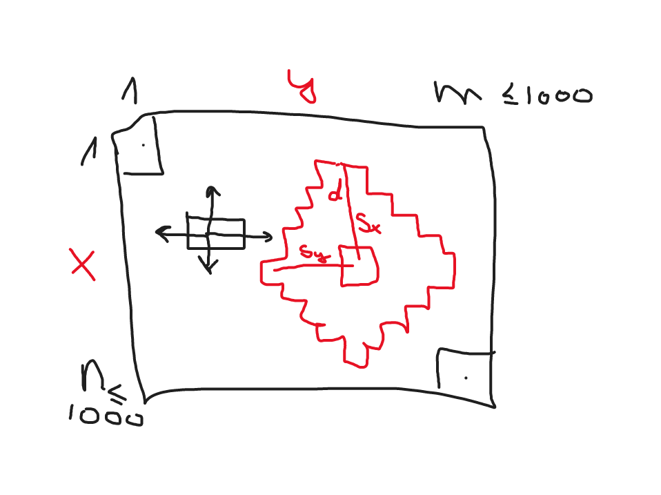
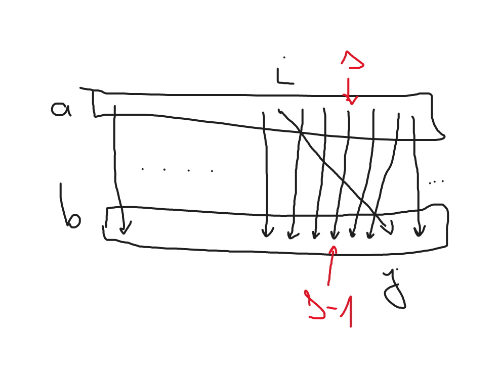
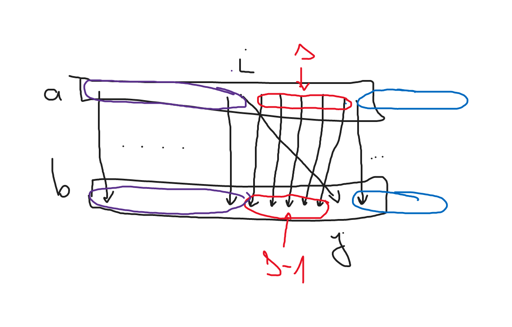

# Feladatok és megoldások - 2022

## Szakköri feladatok

### 01 - Image

https://codeforces.com/group/2cnVva0QXt/contest/399604/problem/01

#### Megoldás

Következő esetek lehetségesek:

- 4 különböző szín: 1-1-1-1
- 3 különböző szín: 1-1-2
- 2 különböző szín: 1-3 vagy 1-3
- 1 szín: 4

- A 4 különböző színnél az első lépés biztosan valakit átszínezni egy másik létező színre.
  - Tehát 1-1-1-1 -> 1-1-2 lépés.
- 1-1-2 esetén vagy a két egyedi színből csinálunk egyet (2-2) vagy valamelyik egyedit igazítjuk a 2-es csoport színéhez (1-3).
- Teljesen mindegy melyiket lépjük, mert utána 2-2 és 1-3 is egy lépésben megoldható (4).
- Tehát 1-1-2 két lépésben megoldható.
- Tehát 1-1-1-1 3 lépésben megoldható.

Tömören: 1-1-1-1 -> 1-1-2 -> 2-2 vagy 1-3 -> 4.

Ezen a ponton már le tudjuk kódolni.

##### Mitől lesz "oneliner"

- `c=input()+input()` kód 2 sort olvas be stdinről és konkatenálja őket (Python string konkatenáció: +), majd beteszi a 4 karaktert c-be.
- Nem számít mik a színek betűjelei, csak az, hogy hány darab van belőlük. Megszámolhatnánk őket a [Counter](https://docs.python.org/3/library/collections.html#collections.Counter) collection objecttel.
- De mégegy megfigyelés: A megoldáshoz vezető lépések száma pont az azonos színű csoportok darabszáma-1. Azaz `len(set(c))-1`-t kel kiírni.

#### Implementációk

- https://codeforces.com/contest/1721/submission/169816722
  - Counteres megoldás.

- https://codeforces.com/contest/1721/submission/170773003
  - Szorzás = string konkatenáció annyiszor.
  - Exec végrehajtja a stringet.

- https://codeforces.com/contest/1721/submission/169932569
  - Golf!

- Forráskódok: [image.py](../kodok/2022/image.py), [image_oneliner.py](../kodok/2022/image-oneliner.py).
- [Tesztadatok](../tesztek/2022/image/)

### 02 - Deadly Laser

https://codeforces.com/group/2cnVva0QXt/contest/399604/problem/02

#### Megoldás



- Legegyszerűbb a falak mellett elmenni: felső + jobb vagy bal + alsó fal.
- Mikor nem lehet így? > Ha mindkét útvonal blokkolva van.
- Mikor van mindkét útvonal blokkolva? Alábbi 4 eset valamelyike:
  - Felső + alsó fal blokkolva: Függőleges elválasztó. > Egyáltalán nincs megoldás.
  - Felső + bal fal blokkolva: Kezdőpont lezárva. (Am ez az eset ki van zárva a feladat szövege szerint.)
  - Alsó + jobb fal blokkolva: Végpont lezárva. > Egyáltalán nincs megoldás.
  - Bal + jobb fal blokkolva: Víszintes elválasztó. > Egyáltalán nincs megoldás.

Tehát vagy a fenti 4 eset egyike van és nem megoldható, vagy a falak mellett elmenve n+m-2 lépéssel megoldható.

#### Implementációk

- https://codeforces.com/contest/1721/submission/172058848
  - Összevonta az eseteket.

- https://codeforces.com/contest/1721/submission/171332066
  - DEMORGAN

- https://codeforces.com/contest/1721/submission/170338551
  - Template fun.

- https://codeforces.com/contest/1721/submission/169815901
  - input = sys.stdin.readline
  - https://codeforces.com/blog/entry/71884

- Forráskódok: [laser.py](../kodok/2022/deadly-laser.py).
- [Tesztadatok](../tesztek/2022/deadly-laser/)

### 03 - Min-Max Array Transformation

https://codeforces.com/group/2cnVva0QXt/contest/399604/problem/03

- Ha az nem jó megoldás, hogy di = bi-ai, vagyis minden ai az ugyanolyan indexű bi-vel van párban, akkor a feladat nem is megoldható.
- Ha megoldható a feladat, akkor az a kérdés, hogy függetlenül egymástól a di változóknak mi a minimum és maximum értéke.
- Ezért kiindulunk abból a megoldásból, ahol dk = bk-ak minden k-re, majd egy adott ai-hez helyette egy korábbi bj-t rendelünk (j<i).
- Ameddig bj-ai>=0 addig a megoldás befejezhető: egyszerűen az aj-hez meg a bi-t rendeljük hozzá, a többiek maradnak. Itt látszik, hogy aj < ai < bi, tehát ez jó megoldás lesz.
- Itt ez még működik, de a maximális lehetséges érték keresésénél már nem fog.
- Itt mindenki mást eggyel kell leshiftelni. Annyira messzire tudjuk az ai párját helyezni ameddig még ez a shiftelés nem romlik el (nem lesz negatív a különbség).
- Kb érvelés:
  - Tegyük fel, hogy a[i]-t párba állíthatjuk b[j]-vel (befejezhető ez a megoldás), de mégis közben van egy a[s] és b[s-1] pár ahol a[s] > b[s-1], tehát nem párba állíthatók.
  - Ekkor a b[s-1]-nek ki legyen a párja? Ha a[s]-től balra keresünk neki párt, pl a[l] l<s-t, akkor az egy ugyanilyen problémát fog okozni, b[l]-nek nem lesz párja. Hiába cseréljük kisebbre, csak görgetjük magunk előtt a hibát.
  - a[s]-től jobbra pedig csak növekednek az a értékek, tehát csak rosszabb lesz a helyzet.



- Kb érvelés 2:
  - Az a tömbben piros halmaz darabnyi elemet kell az i-j átló bal oldalára / "eggyel hátrébb" behúzni, tehát ha a piros halmazon belül van egy túl nagy különbség "hátra", az valamelyik behúzásban benne lesz, tehát túl nagy lesz a különbség "hátra" = negatív lesz.



- Ugyanez a kötözgetés előre irányban is működik egyébként, de ott egyszerűbb a helyzet.

#### Implementációk

- https://codeforces.com/contest/1721/submission/172032690
  - Más logika a hátrafelé menéshez.

- https://codeforces.com/contest/1721/submission/171672377
  - Ez a mienk.

- https://codeforces.com/contest/1721/submission/170864312
  - Lol komment. :)

- https://codeforces.com/contest/1721/submission/169877236
- https://codeforces.com/contest/1721/submission/170001390
- https://codeforces.com/contest/1721/submission/169825908

- Forráskódok: [minmax.cpp](../kodok/2022/min-max-array-transformation.cpp), [minmax.py](../kodok/2022/min-max-array-transformation.py).
- [Tesztadatok](../tesztek/2022/min-max-array-transformation/)

### 04 - Robot in a Hallway

https://codeforces.com/group/2cnVva0QXt/contest/399604/problem/04

- Forráskódok: [robot_accepted.cpp](../kodok/2022/robot-in-a-hallway-accepted.cpp), [robot_brabemachess.cpp](../kodok/2022/robot-in-a-hallway-brabemachess.cpp), [robot_slow.cpp](../kodok/2022/robot-in-a-hallway-slow.cpp), [robot_test_generator.cpp](../kodok/2022/robot-in-a-hallway-test-generator.cpp).
- [Tesztadatok](../tesztek/2022/robot-in-a-hallway/)

### 05 - Palindrome Basis

https://codeforces.com/group/2cnVva0QXt/contest/399604/problem/05

#### Megoldás

- n legfeljebb 40,000, azaz eddig előállítunk minden palindromot gyorsan -> p[] tömbben tároljuk őket.
- DP-s megoldás:
  - DP[sum, i]: Az első i db palindromot felhasználva a sum összeg hányféleképpen állítható elő.
  - Két eset van: i. palindromot vagy felhasználjuk sum-ban, vagy nem.
  - DP[sum, i] = DP[sum, i-1] + DP[sum-p[i], i].
    - (Ha bármelyik index negatív definiáljuk 0-nak a DP tömb ottani értékét.)
    - Az összeg második tagja DP[sum-p[i], i] specifikusan nem i-1 az index itt, mivel egy palindromot többször is felhasználhatunk az összegben.
  - DP[0, 0] = 1.
- Előzetesen kiszámoljuk egyszer a tömböt max(n_j)-re, minden teszteset 1 lookup.

- Forráskódok: [palindrome.cpp](../kodok/2022/palindrome-basis.cpp).
- [Tesztadatok](../tesztek/2022/palindrome-basis/)

### 06 - Rescue

- Forráskódok: [rescue.cpp](../kodok/2022/rescue.cpp).
- [Tesztadatok](../tesztek/2022/rescue/)

### 07 - Storage

- Forráskódok: [storage.cpp](../kodok/2022/storage.cpp).
- [Tesztadatok](../tesztek/2022/storage/)

### 09 - March of the Penguins

- Forráskódok: [edmonds_karp.cpp](../kodok/2022/march-of-the-penguins-edmonds-karp.cpp), [n0F4x.cpp](../kodok/2022/march-of-the-penguins-n00f04x.cpp).
- [Tesztadatok](../tesztek/2022/march-of-the-penguins/)

### 10 - Array and Operations

- Forráskódok: [array_operations.cpp](../kodok/2022/array-and-operations.cpp), [primes.cpp](../kodok/2022/array-and-operations-primes.cpp).
- [Tesztadatok](../tesztek/2022/array-and-operations/)

## ICPC Hungary 2022

### A - Adaptive Morse

- [Feladatleírás](../pdfek/2022/icpc-hungary-adaptive-morse.pdf)
- Forráskódok: [morse.py](../kodok/2022/icpc-hungary-adaptive-morse-morse.py), [official_adaptivemorse.cpp](../kodok/2022/icpc-hungary-adaptive-morse-hivatalos.cpp).
- [Tesztadatok](../tesztek/2022/icpc-hungary-adaptive-morse/)

#### Megoldás

- Célszerű megszámolni az inputot, hogy melyik karakterből hány darab van, majd a gyakoribb karakterekhez rendelni a legrövidebb Morse-szerű kódokat.
- Ehhez célszerű kiszámolni előre, hogy milyen hosszú Morse-szerű kódból hány darab van.
- Ez megtehető kézzel, papíron is, de egyszerűbb lekódolni.
- A kódoláshoz azt kell észrevenni, hogy dinamikus programozással megoldható a feladat.

##### Dinamikus programozás

- Észrevétel: Adott hosszúságú kód vagy `.`-ra vagy `-`-re végződik.
- Jelentse a DP táblában a `DP[i]` cella azt, hogy $i$ hosszúságú Morse-szerű kódból hány darab van.
- A `.`-ra végződő $i$ hosszúságú kódokból hány darab van?
  - Pont annyi, mint amennyi $i-2$ hosszúságú kód (`DP[i-2]`), hiszen ezekhez lehet egy 1 hosszúságú 'inner gap' és egy 1 hosszúságú `.` hozzáadásával `.`-ra végződő $i$ hosszúságú kódot kapni.
- A `-`-re végződő $i$ hosszúságú kódokból hány darab van?
  - Pont annyi, mint amennyi $i-4$ hosszúságú kód (`DP[i-4]`), hiszen ezekhez lehet egy 1 hosszúságú 'inner gap' és egy 3 hosszúságú `-` hozzáadásával `-`-re végződő $i$ hosszúságú kódot kapni.
- Azaz a lépés képlete `DP[i] = DP[i-2] + DP[i-4]`.
- Kezdésképp:
  - `DP[1] = 1`, hiszen a `.` mint Morse-szerű karakter 1 hosszú és más ilyen nincs.
  - `DP[3] = 2`, hiszen a `..` és a `-` mint Morse-szerű karakterek 3 hosszúak és más ilyen nincs.
- Majd `i=5` és fölötte már alkalmazható az általános lépés képlete.
- A DP táblát elég kevés $n$-re (pl. nálam $n=21$-ig) kiszámolni, mert összesen az angol ABC 26 karakterét kell csak lefedni, tehát a DP[0..n] összegének kell legalább 26-nak lennie, ez bőven megvan.

##### Körítés

- A DP-s előfeldolgozás után karakter előfordulási gyakoriság szerint rendeljük hozzá a kódokat a karakterekhez.
- A végén még a 3 hosszú 'karakterek közötti gap'-et rá kell számolni, de ez pont az input hossza - 1.
- A legelején a feladat szövegében említett whitespace és punctuation karaktereket kidobjuk az inputból és egységesen lowercase-é alakítjuk a szöveget.

### B - Budapest Hold’em

- [Feladatleírás](../pdfek/2022/icpc-hungary-budapest-holdem.pdf)
- Forráskódok: [official_budapestholdem.cpp](../kodok/2022/icpc-hungary-budapest-holdem-hivatalos.cpp), [poker.py](../kodok/2022/icpc-hungary-budapest-holdem-poker.py).
- [Tesztadatok](../tesztek/2022/icpc-hungary-budapest-holdem/)

#### Megoldás

- Beolvassuk a kártyákat, csak az első karakter számít mindegyikből.
- Megszámoljuk melyikből mennyi van.
- Kiírjuk a legnagyobb darabszámot.

#### Észrevételek

- Pythonban a [Counter](https://docs.python.org/3/library/collections.html#collections.Counter) osztály használható elemek számolására beépítetten.
  - Ezen a `most_common` függvényt hívva csökkenő sorredbe állítjuk a kulcsokat.
  - A konstruktorának meg lehet adni bármilyen iterálható inputot.

### C - Computer Cache

- [Feladatleírás](../pdfek/2022/icpc-hungary-computer-cache.pdf)
- Forráskódok: [official_computercache.cpp](../kodok/2022/icpc-hungary-computer-cache-hivatalos.cpp).
- [Tesztadatok](../tesztek/2022/icpc-hungary-computer-cache/)

### D - Devil’s Algorithm

- [Feladatleírás](../pdfek/2022/icpc-hungary-devils-algorithm.pdf)
- Forráskódok: [official_devilsalgorithm.cpp](../kodok/2022/icpc-hungary-devils-algorithm-hivatalos.cpp), [rubik.py](../kodok/2022/icpc-hungary-devils-algorithm-rubik.py).
- [Tesztadatok](../tesztek/2022/icpc-hungary-devils-algorithm/)

#### Megoldás

- Három eset van:
- Ha Claire 5. eredménye lesz az eddigi legjobbja, akkor a 4 korábbi eredményből a 3 legkisebb átlaga kell, hogy legfeljebb annyi legyen mint az elérni kívánt cél.
  - Ha még így is az elérni kívánt célnál nagyobb az átlag, akkor lehetetlen olyan jó eredményt elérni, hogy a célt elérjük vele.
- Ha Claire 5. eredménye lesz az eddigi legrosszabbja, akkor a 4 korábbi eredményből a 3 legnagyobb átlaga kell, hogy legfeljebb annyi legyen, mint az elérni kívánt cél.
  - Ha ezeknek az átlaga eléri a célt, akkor bármi is az 5. eredmény, biztosan megoldható a feladat, ilyenkor írunk ki "infinite"-t.
- Egyéb esetben pedig az van, hogy az 5. eredmény szerepelni fog az átlagban, a 4 korábbi eredményből a 2 középső mellett.
  - Ilyenkor 1 ismeretlenes egyenlet megoldásával megadható minek kell az 5. eredménynek lennie.

#### Észrevételek

- A feladat megoldásában fontos szerepet játszik, hogy ismerjük-e hogyan kell floating point számokkal számolni versenyeken.
- Minden olyan esetben amikor tört számokat hasonlítunk össze (`==`, `<=`, stb.), mindenképp jusson eszünkbe a floating point precision.
- Más jellegű feladatokban még az is előfordulhat, hogy egy `epsilon` pontossági hibát meg kell engedni az összehasonlításkor, ilyenkor a feladat szövege említi a megengedett pontossági hibát. Itt ez nem játszik.

##### Trükk 1

- Amikor átlagolni akarunk 3 számot és azt összehasonlítani a target-el az problémás.
- Ilyenkor osztás helyett mindig vigyük át a másik oldalra és csináljunk belőle szorzást!
- Azaz `s[0] + s[1] + s[2] <= target / 3` helyett `3*(s[0] + s[1] + s[2]) <= target` legyen.

##### Trükk 2

- Emellett pedig a bemeneti értékeket fel kell szorozni 100-al, így egész számok lesznek.
- Különben hiába olvasunk be például `6.38`-at, az valójában `6.2999999999999998`-ként fog tárolódni. Lásd az alábbi kód kimenetét:

```cpp
#include <iostream>
#include <limits>

using namespace std;

typedef std::numeric_limits<double> dbl;

int main() {
  double a = 6.3;
  cout.precision(dbl::max_digits10);
  cout << a << endl;
  return 0;
}
```

##### Megjegyzés

- A feladat szövegéből nem derül ki egyértelműen, hogy az átlagolás művelet eredményét milyen pontossággal kell érteni. Mivel a be- és kimenetek is $2$ tizedesjegy pontossággal adandóak meg, ezért felmerülhet az a kérdés, hogy az átlag számítás eredményét is kerekíteni kellene.
  - Ha ez így lenne, akkor például a `0.50 1.00 1.00 2.00` eddigi eredmények és `1.00` target esetében megengedhető lenne az `1.01`-es 5. eredmény is, hiszen a `0.01` fölöslegből az átlagoláskor `0.00333333...` keletkezik, amit 2 tizedesjegyre kerekítve `0.00`-t kapunk.
  - Valószínűleg a feladat ezt nem így érti, mivel például az én mellékelt megoldásomat is elfogadta és a fenti logika nagyon sok bemenet esetén működik, ezért valószínűleg van ilyen hidden teszteset.

### E - Elon’s Eagle

- [Feladatleírás](../pdfek/2022/icpc-hungary-elons-eagle.pdf)
- Forráskódok: [official_elonseagle.cpp](../kodok/2022/icpc-hungary-elons-eagle-hivatalos.cpp).
- [Tesztadatok](../tesztek/2022/icpc-hungary-elons-eagle/)

### F - Freybug Frenzy

- [Feladatleírás](../pdfek/2022/icpc-hungary-freybug-frenzy.pdf)
- Forráskódok: [f.cpp](../kodok/2022/icpc-hungary-freybug-frenzy-megoldas.cpp), [official_freybugfenzy.cpp](../kodok/2022/icpc-hungary-freybug-frenzy-hivatalos.cpp).
- [Tesztadatok](../tesztek/2022/icpc-hungary-freybug-frenzy/)

#### Megoldás

- Egy kicsit nehéz rájönni a feladat szövegéből hogy mit vár el:
  - Tulajdonképpen azt kell nézni, hogy az $n$ elemből az összes lehetséges módon kiválasztunk $k$ darabot és ezekre a lehetőségekre számoljuk ki a módosított spawn chance-ek átlagát.
  - A módosított spawn chance-ket úgy kapjuk, hogy adott $k$ kiválasztásra, hogy a nem kiválasztottak valószínűségét hozzáadjuk a sorrendben az utánuk következő első már kiválasztott elemhez.
- Ez már jó megoldás lenne, csak lassú, hiszen $\binom{n}{k}$, ha $k,n \leq{} 500$, túl sok lenne.
- Helyette úgy gondolkozunk, hogy amikor az $i$. elem-re számoljuk az átlagot, kiszámoljuk azt, hogy hány olyan $\binom{n}{k}$ kiválasztás van, amire az előtte lévő $j$. elem valószínűsége hozzáadódik az $i$-jéhez.
- Ilyen akkor van, ha a $[j,i-1]$ intervallumon nem választottunk ki senkit, az $i$. elemet pedig kiválasztottuk, továbbá a maradék $n-(i-j+1)$ elemből kell $k-1$-et kiválasztani, ez akkor $\binom{n-(i-j+1)}{k-1}$-féleképpen lehetséges, a nevezőben pedig az $\binom{n}{k}$ össz-valószínűség szerepel.

$$\frac{\binom{n-(i-j+1)}{k-1}}{\binom{n}{k}} = \frac{\frac{(n-(i-j+1))!}{(n-(i-j+1)-(k-1))!(k-1)!}}{\frac{n!}{k!(n-k)!}} = \frac{\frac{(n-i+j-1))!}{(n-i+j-k)!(k-1)!}}{\frac{n!}{k!(n-k)!}} = \frac{k!(n-k)!(n-i+j-1))!}{n!(n-i+j-k)!(k-1)!} = \frac{k\cdot{}(n-i+j-1)\cdot{}\dots{}\cdot{}(n-i+j-k+1)}{n\cdot{}\dots{}\cdot{}(n-k+1)} $$

- A fenti képletet inkrementálisan $j=i-1$-től kezdve számolhatjuk ki, a korábbi $j$-re kiszámolt érték megfelelő törttel való szorzásával.

 ## Észrevételek

 - A fenti logikában sokaknak feltűnhet, hogy tulajdonképpen összefüggő eseményekre számoltunk valamilyen átlagot (várható értéket).
 - Fontos ismerni a valszámos progversenyes feladatokhoz, hogy a várható érték lineáris, [**counter-intuitív módon az összefüggő események esetében is**](https://brilliant.org/wiki/linearity-of-expectation/), tehát az összeg várható értéke a várható érték összege, vagyis a fenti logikát megtehetjük.
 - Indikátor esemény várható értéke a valószínűsége, ezért a fenti érvelés a valószínűségekre is végiggondolható, ahol az $n$-ből adott $k$ db kiválasztásához kapcsolódó indikátor valószínűségi változó várható értékeként fogalmazzuk meg a megfelelő spawn chance-t.

### G - Grand Scheme of Things

- [Feladatleírás](../pdfek/2022/icpc-hungary-grand-scheme-of-things.pdf)
- Forráskódok: [official_grandscheme.cpp](../kodok/2022/icpc-hungary-grand-scheme-of-things-hivatalos.cpp).
- [Tesztadatok](../tesztek/2022/icpc-hungary-grand-scheme-of-things/)

#### Megoldás

- Kulcsmondat: It is guaranteed that the sum over all $m_i$ is at most $200 000$.
- Reprezentáljuk a feladatot páros gráfként!
- Legyenek az A színosztály csúcsai az emberek, a B színosztály csúcsai pedig a különböző számaik (amik majd közösek lehetnek).
- Kössön össze akkor él $a\in{}A$ elemet $b\in{}B$-vel ha az $a$ csúcshoz tartozó embernek száma a $b$ csúcshoz tartozó szám.
- Emberből legfeljebb $2\cdot{}10^5$ van, a számok ugyan lehetnek legfeljebb $10^9$ értékűek, de legfeljebb azokból is csak $2\cdot{}10^5$ lesz a fenti kulcsmondatból következően.
- A kulcsmondat miatt ebben a gráfban legfeljebb $2\cdot{}10^5$ él van.
- A gráfot bejárjuk, például szélességi kereséssel $O(|V|+|E|)$, kb $const\cdot{}10^5$ lépésben. Ha összefüggő akkor van megoldás, ha nem összefüggő akkor nincs.
- Ha van megoldás, akkor azt a szélességi bejárás közben írhatjuk fel:
  - Amikor egy $a_1 \in{} A$ csúcsból $b\in{}B$-be lépünk, majd onnan $a_2\in{}A$-ba, akkor az " $a_2$ $a_1$ $b$ " sort jegyezzük meg az $a_2$-höz.

#### Észrevételek

- Más gráfreprezentáció is eszünkbe juthat, például egy olyan ahol az emberek a csúcsok és akkor megy él két csúcs között, ha van közös számuk.
- Ebben az esetben figyelni kell arra, hogy az éleket nem fogjuk tudni előre kiszámolni, mivel ahhoz ~ $10^{10}$ lépés kellene, ezért trükkösen kell csinálni, hogy a BFS beleférjen.
- Jó trükk ezért ilyen feladatokban, hogy többféle gráfreprezentációt is kipróbálunk és megnézzük melyiket könnyebb-nehezebb használni, kihasználni vele a feladat korlátait.

### H - How Did You Know?

- [Feladatleírás](../pdfek/2022/icpc-hungary-how-did-you-know.pdf)
- Forráskódok: [even.py](../kodok/2022/icpc-hungary-how-did-you-know-even.py), [official_howdidyou.cpp](../kodok/2022/icpc-hungary-how-did-you-know-hivatalos.cpp).
- [Tesztadatok](../tesztek/2022/icpc-hungary-how-did-you-know/)

#### Megoldás

- 1-100 közötti számból gondolhatott Alex $n\leq{}10$ darab egymást követőre.
- Ha tudjuk az n-et akkor az összegük csak páros vagy csak páratlan vagy mindkettő lehet?
- Ez első körben függ attól, hogy n páros-e vagy páratlan:
  - Ha n páratlan, akkor az összeg mindkettő lehet, hiszen:
    - Ha veszem az első n darab számot ( $[1, n]$ ), akkor ezeknek az összege vagy páros vagy páratlan.
    - Ezután eltolom 1-el jobbra az intervallumot ( $[2, n]$ ), akkor minden szám értéke 1-el nőtt.
    - Ekkor az összegük $n$-el nőtt, ami páratlan.
    - Tehát bármi is volt a paritása az $[1, n]$ összegének, az most az ellenkezőjére változott.
    - Tehát páros és páratlan is lehet az összeg.
    - (Itt fontos, hogy $n\leq{}10$, tehát az $[1,100]$ intervallumba beleesik az $n+1$.)
  - Ha n páros, akkor az összeg attól függ, hogy mennyi a négyes maradéka = hány páratlan szám van az $n$ darab között.
    - Ha a $4$-es maradék $0$, akkor páros sok páratlan szám van, amiknek az összege páros. A páros számok összege szintén páros, tehát ilyenkor páros a teljes összeg.
    - Ha a $4$-es maradék $2$, akkor páratlan sok páratlan szám van, amiknek az összege páratlan. A páros számok összege továbbra is páros, tehát ilyenkor páratlan a teljes összeg.

#### Észrevételek

- Az általam leadott forráskód kihasználja azt, hogy az integerek implicit bool-á castolódnak.
  - A 0 false, minden más true.
  - Így pl. $n$ oszthatósága $k$-val így ellenőrizhető: `if (n%k) { /* Nem osztható. */ } else { /* Osztható. */ }`

### I - Illustration Cropping

- [Feladatleírás](../pdfek/2022/icpc-hungary-illustration-cropping.pdf)
- Forráskódok: [official_illustration.cpp](../kodok/2022/icpc-hungary-illustration-cropping-hivatalos.cpp).
- [Tesztadatok](../tesztek/2022/icpc-hungary-illustration-cropping/)

### J - Jammed Carry Bar

- [Feladatleírás](../pdfek/2022/icpc-hungary-jammed-carry-bar.pdf)
- Forráskódok: [main.cpp](../kodok/2022/icpc-hungary-jammed-carry-bar-megoldas.cpp), [official_jammedcarry.cpp](../kodok/2022/icpc-hungary-jammed-carry-bar-hivatalos.cpp).
- [Tesztadatok](../tesztek/2022/icpc-hungary-jammed-carry-bar/)

### K - Katatonic Set

- [Feladatleírás](../pdfek/2022/icpc-hungary-katatonic-set.pdf)
- Forráskódok: [k.cpp](../kodok/2022/icpc-hungary-katatonic-set-megoldas.cpp), [official_katatonic.cpp](../kodok/2022/icpc-hungary-katatonic-set-hivatalos.cpp).
- [Tesztadatok](../tesztek/2022/icpc-hungary-katatonic-set/)

### L - Low-cost Transformation

- [Feladatleírás](../pdfek/2022/icpc-hungary-low-cost-transformation.pdf)
- Forráskódok: [official_lowcost.cpp](../kodok/2022/icpc-hungary-low-cost-transformation-hivatalos.cpp), [trafo.py](../kodok/2022/icpc-hungary-low-cost-transformation-trafo.py).
- [Tesztadatok](../tesztek/2022/icpc-hungary-low-cost-transformation/)

#### Megoldás

- Amíg $A$ nagyobb mint $B$, addig muszáj osztani, mert másképp nem tudjuk csökkenteni az értékét.
- Ha $A$ páratlan akkor csak úgy tudjuk leosztani, ha előtte hozzáadunk $1$-et.
- Ha még fogunk később osztani, akkor nem érdemes egymás után többször is hozzáadni $1$-et $A$-hoz, hiszen az osztás után $1$-el kevesebb művelettel ugyanazt az eredményt érjük el.
- Ha $A$ kisebb mint $B$, akkor addig adunk hozzá $1$-et, amíg $A=B$ nem lesz.

### M - Morning Show

- [Feladatleírás](../pdfek/2022/icpc-hungary-morning-show.pdf)
- Forráskódok: [M.cpp](../kodok/2022/icpc-hungary-morning-show-megoldas.cpp), [official_morning.cpp](../kodok/2022/icpc-hungary-morning-show-hivatalos.cpp), [ticket.cpp](../kodok/2022/icpc-hungary-morning-show-ticket.cpp).
- [Tesztadatok](../tesztek/2022/icpc-hungary-morning-show/)

## ICPC CERC 2022

[Hivatalos megoldásleírások](../pdfek/2022/icpc-cerc-2022-megoldasok.pdf)

### A - Bandits

- [Feladatleírás](../pdfek/2022/icpc-cerc-bandits.pdf)
- Forráskódok: [official_bandits.cpp](../kodok/2022/icpc-cerc-bandits-hivatalos.cpp).
- [Tesztadatok](../tesztek/2022/icpc-cerc-bandits/)

### B - Combination Locks

- [Feladatleírás](../pdfek/2022/icpc-cerc-combination-locks.pdf)
- Forráskódok: [official_locks.cpp](../kodok/2022/icpc-cerc-combination-locks-hivatalos.cpp).
- [Tesztadatok](../tesztek/2022/icpc-cerc-combination-locks/)

### C - Constellations

- [Feladatleírás](../pdfek/2022/icpc-cerc-constellations.pdf)
- Forráskódok: [c.cpp](../kodok/2022/icpc-cerc-constellations-megoldas.cpp), [official_constellations.cpp](../kodok/2022/icpc-cerc-constellations-hivatalos.cpp), [team_yes_constellations.cpp](../kodok/2022/icpc-cerc-constellations-team-yes-constellations.cpp).
- [Tesztadatok](../tesztek/2022/icpc-cerc-constellations/)

### D - Deforestation

- [Feladatleírás](../pdfek/2022/icpc-cerc-deforestation.pdf)
- Forráskódok: [official_deforestation.cpp](../kodok/2022/icpc-cerc-deforestation-hivatalos.cpp), [official_deforestation_py.py](../kodok/2022/icpc-cerc-deforestation-hivatalos-deforestation-py.py), [official_solve.py](../kodok/2022/icpc-cerc-deforestation-hivatalos-solve.py).
- [Tesztadatok](../tesztek/2022/icpc-cerc-deforestation/)

### E - Denormalization

- [Feladatleírás](../pdfek/2022/icpc-cerc-denormalization.pdf)
- Forráskódok: [official_normalization.cpp](../kodok/2022/icpc-cerc-denormalization-hivatalos.cpp), [team_bute_1.cpp](../kodok/2022/icpc-cerc-denormalization-team-bute-01.cpp), [team_yes.cpp](../kodok/2022/icpc-cerc-denormalization-team-yes.cpp).
- [Tesztadatok](../tesztek/2022/icpc-cerc-denormalization/)

### F - Differences

- [Feladatleírás](../pdfek/2022/icpc-cerc-differences.pdf)
- Forráskódok: [official_differences.cpp](../kodok/2022/icpc-cerc-differences-hivatalos-differences.cpp), [official_josip.cpp](../kodok/2022/icpc-cerc-differences-hivatalos-josip.cpp).
- [Tesztadatok](../tesztek/2022/icpc-cerc-differences/)

### G - Greedy Drawers

- [Feladatleírás](../pdfek/2022/icpc-cerc-greedy-drawers.pdf)
- Forráskódok: [official_counter_100_percent.py](../kodok/2022/icpc-cerc-greedy-drawers-hivatalos-counter-100-percent.py), [official_drawers.py](../kodok/2022/icpc-cerc-greedy-drawers-hivatalos-drawers.py).
- [Tesztadatok](../tesztek/2022/icpc-cerc-greedy-drawers/)

### H - Insertions

- [Feladatleírás](../pdfek/2022/icpc-cerc-insertions.pdf)
- Forráskódok: [official_insertion-pruned-nlogn.cpp](../kodok/2022/icpc-cerc-insertions-hivatalos-insertion-pruned-nlogn.cpp), [official_insertion.cpp](../kodok/2022/icpc-cerc-insertions-hivatalos-insertion.cpp), [official_insertions.cpp](../kodok/2022/icpc-cerc-insertions-hivatalos-insertions.cpp).
- [Tesztadatok](../tesztek/2022/icpc-cerc-insertions/)

### I - Money Laundering

- [Feladatleírás](../pdfek/2022/icpc-cerc-money-laundering.pdf)
- Forráskódok: [official_money.cpp](../kodok/2022/icpc-cerc-money-laundering-hivatalos-money.cpp), [official_sol.cpp](../kodok/2022/icpc-cerc-money-laundering-hivatalos-sol.cpp).
- [Tesztadatok](../tesztek/2022/icpc-cerc-money-laundering/)

### J - Mortgage

- [Feladatleírás](../pdfek/2022/icpc-cerc-mortgage.pdf)
- Forráskódok: [official_mortgage.cpp](../kodok/2022/icpc-cerc-mortgage-hivatalos-mortgage.cpp), [official_solution.cpp](../kodok/2022/icpc-cerc-mortgage-hivatalos-solution.cpp).
- [Tesztadatok](../tesztek/2022/icpc-cerc-mortgage/)

### K - Skills in Pills

- [Feladatleírás](../pdfek/2022/icpc-cerc-skills-in-pills.pdf)
- Forráskódok: [official_greedy.cpp](../kodok/2022/icpc-cerc-skills-in-pills-hivatalos-greedy.cpp), [official_pills.cpp](../kodok/2022/icpc-cerc-skills-in-pills-hivatalos-pills.cpp).
- [Tesztadatok](../tesztek/2022/icpc-cerc-skills-in-pills/)

### L - The Game

- [Feladatleírás](../pdfek/2022/icpc-cerc-the-game.pdf)
- Forráskódok: [official_game.py](../kodok/2022/icpc-cerc-the-game-hivatalos.py).
- [Tesztadatok](../tesztek/2022/icpc-cerc-the-game/)

### X - Chronogram

- [Feladatleírás](../pdfek/2022/icpc-cerc-chronogram.pdf)
- Forráskódok: [official_chronogram.cpp](../kodok/2022/icpc-cerc-chronogram-hivatalos-chronogram.cpp), [official_chronogram.py](../kodok/2022/icpc-cerc-chronogram-hivatalos.py), [official_crono.cpp](../kodok/2022/icpc-cerc-chronogram-hivatalos-crono.cpp).
- [Tesztadatok](../tesztek/2022/icpc-cerc-chronogram/)

### Y - Permutations

- [Feladatleírás](../pdfek/2022/icpc-cerc-permutations.pdf)
- Forráskódok: [official_permutacije.java](../kodok/2022/icpc-cerc-permutations-hivatalos.java), [official_permutations.cpp](../kodok/2022/icpc-cerc-permutations-hivatalos.cpp), [y.cpp](../kodok/2022/icpc-cerc-permutations-megoldas.cpp).
- [Tesztadatok](../tesztek/2022/icpc-cerc-permutations/)

### Z - Sokoban

- [Feladatleírás](../pdfek/2022/icpc-cerc-sokoban.pdf)
- Forráskódok: [official_main.java](../kodok/2022/icpc-cerc-sokoban-hivatalos.java), [official_sokoban.cpp](../kodok/2022/icpc-cerc-sokoban-hivatalos.cpp).
- [Tesztadatok](../tesztek/2022/icpc-cerc-sokoban/)
