# Versenyprogramozás - 2022

## 2022-09-01 - VProg Student Club - Fall 2022

The competitive programming (ACM ICPC, Google Code Jam, Codeforces, etc) study groups are continued this semester, organized by [BME VIK SZIT](http://cs.bme.hu/english/)!

### Coordinates

- **Time**: Weekly on Friday, 15:00 - 16:30.
- **Location**: This semester is online, on Zoom.

The study group is open to everyone: beginners and advanced students, students from other universities, and others outside of the university are also welcomed. :)

### Links

- **(New!) Discord server**: <https://vprog.hu/discord>
  - Chat, organization, news, information.
  - The Teams group is soon to be archived. :)
- **Zoom meeting join**: <https://vprog.hu/zoom>
  - Join the online location.
- **Codeforces group invite**: <https://vprog.hu/codeforces>
  - Submission of solutions, look at each other's code.
- **Miro board**: <https://vprog.hu/whiteboard>
  - Online whiteboard, that can be edited together.

Viktória Nemkin
[nemkin@cs.bme.hu](mailto:nemkin@cs.bme.hu)

## 2022-10-03 - ICPC 2022 Registration

### Coordinates

- **Date**: 2022 October 15 (Saturday)
  - **Arrive by**: 9:00
  - **Competition**: 10:00 - 15:00
- **Place**: Lágymányosi ELTE Campus, Southern Block, Room "Lovarda". Enter from the northen entrance, turn left immediately.

### Registration

Teams should consist of 3 people, all students at BME. Registration is via email.

- **Deadline**: 2022 October 12 (Wednesday) 23:59
- **Címzett**: [friedl@cs.bme.hu](mailto:friedl@cs.bme.hu)
- **Subject**: Registration to the ACM competition
- **Data**:
  - Team name
  - Contender data:
    - Name
    - E-mail address
    - Neptune code
    - Major
    - Degree
    - Year of studies

The competition will be preceded by a test, we ask all BME teams to attend this. During this, you can try the submission system and ask for help when needed.

The start of the test is unknown, the competition starts at 10 am and lasts 5 hours. Further information, rules and technical details can be found at ELTE's website: <http://versenyek.inf.elte.hu/>.

The Central European round will be held between 2022 November 25-27 in Ljubljana, Slovenia. The two best BME teams in the 1st round will be eligible to participate.

Only teams in which all three members fulfill the ACM ICPC eligibility criteria will be able to advance to the 2nd round. In short, members must have been born in or after 1999 or must have started university in or after 2018.

See the official [Eligibility Decision Tree](https://drive.google.com/file/d/1E9yaQbpSu9059UrOYafAiNrH-ABgRDAW/view) from last year.

Further information about CERC: <https://cerc.acm.si>

## Szakköri anyagok

[Feladatok és megoldások](../feladatok/2022.md)

## Folyamok
### Hálózat és folyam

#### Példák

Amikre ez a modell passzol:

- Úthálózat, amin termékeket szállítanak.
- Csatornahálózat, amiben folyik a víz.
- Elektromos hálózat, amin áram folyik (lásd Kirchhoff-törvények).
- Internet, amin információ áramlik.
- Advanced: Nem áramlik semmi, lokális kapcsolatokat/kényszereket modellezünk vele. Pl. 10-es feladat.

#### Hálózat

$G(V,E)$ irányított (nem-negatív) élsúlyozott gráf.

- Az élsúlyok kapacitásokat jelölnek: $c: E \rightarrow \mathbb{R}_{\geq{}0}$ kapacitásfüggvény.
- Kitüntetett csúcsok:
  - Source $s\in{}V$: Kiindulópont (termelő), csak kiélei vannak.
  - Target $t\in{}V$: Végállomás (fogyasztó), csak beélei vannak.
- Közbenső csúcs: többiek.

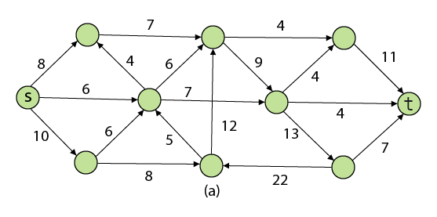

#### Folyam

Élekhez számok (folyamértékek) hozzárendelése $f: E \rightarrow \mathbb{R}_{\geq{}0}$ folyamfüggvény.

Úgy hogy:

- Nem-negatív és a kapacitásnál nem több: $\forall{}e\in{}E$

$$0\leq{} f(e) \leq{}c(e)$$

- Közbenső csúcsba ami befolyik az kifolyik: $\forall{}v\in{}V \setminus{} \\{s,t\\}$

$$\sum\limits_{\forall{}\xrightarrow{e}v} f(e) = \sum\limits_{\forall{}\xleftarrow{e}v} f(e)$$

- A source-ból az folyik ki ami a targetbe befolyik:

$$ \sum\limits_{\forall{}\xleftarrow{e}s} f(e) = \sum\limits_{\forall{}\xrightarrow{e}t} f(e) $$

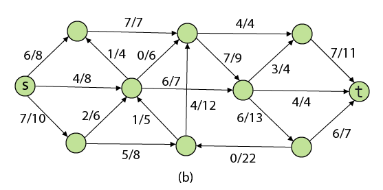

#### Folyam értéke

Amennyi "dolog" "átment" a source-ból a target-ba.

- Leolvasható: Source-ból kimenő VAGY target-be befutó élek folyamértékeinek összege.

### Feladatok

#### Maximális folyam

Mekkora a rendszeren átvihető legnagyobb "mennyiség"?

#### Minimális vágás

- Melyik (legkisebb kapacitásösszegű) éleket kell törölni, hogy a rendszeren ne lehessen semmit átvinni?
- Ha ezeket az éleket kitöröljük, akkor a gráf kettéesik: egy source-t tartalmazó csúcshalmazra és egy target-et tartalmazó csúcshalmazra.
- Nem lesz átjárás a source-ből a target felé.
- Vágás = source csúcshalmaza.
- Vágás kapactása = source csúcshalmazából kimutató élek kapacitásainak az összege.

### Tételek

#### Maximális folyam = minimális vágás tétel

"Bottleneck": A maximális folyam értéke egyezik a minimális vágás kapacitásával.

### Algoritmusok

#### Ford-Fulkerson "módszer"

- Kiindulunk a csupa 0 folyamból.
- Útvonalat keresünk a source-ból a targetbe.
- Útvonal mentén megkeressük a legkisebb kapacitást.
- Annyival növeljük a folyam értékét az útvonal minden élén.
- Ezt addig csináljuk amíg van S-T út.
- Az alábbi példán ezt megnézzük és megmutatom, hogy a maradék hálózat mire jó.

Csupa 0 folyam:
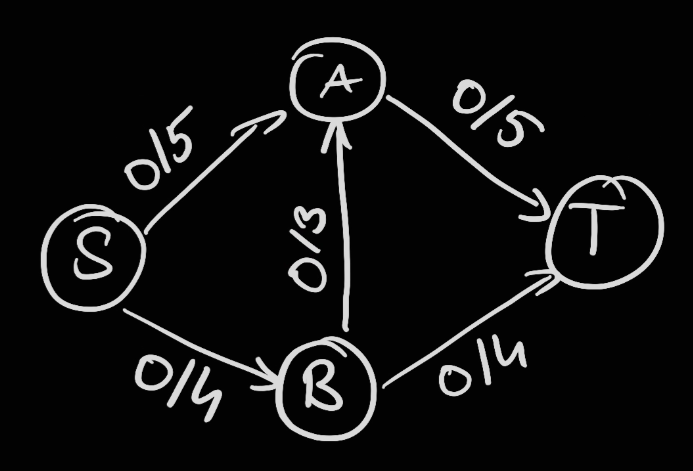

S-t útvonal, amin a bottleneck a B->A, 3-mas kapacitású él:
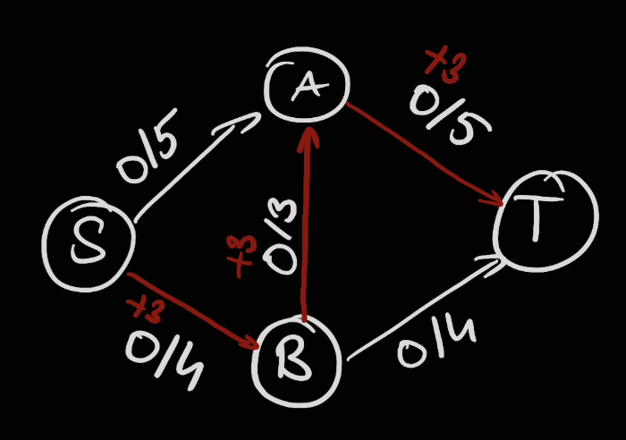

Bővítjük a folyamot az élek mentén 3-mal:
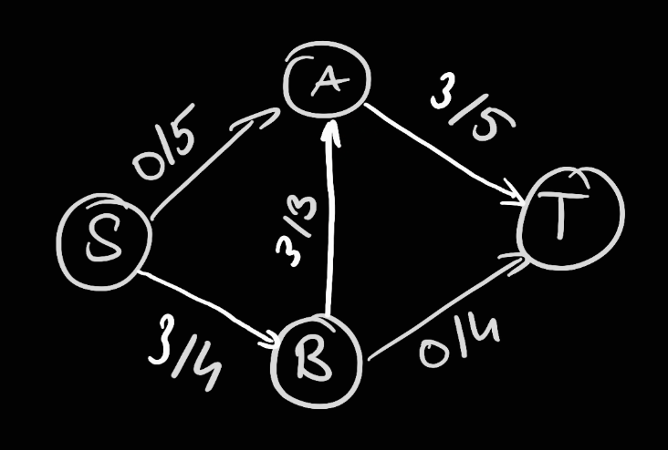

S-t útvonal, amin a bottleneck a maradék 2 kapacitás az A-T élen:
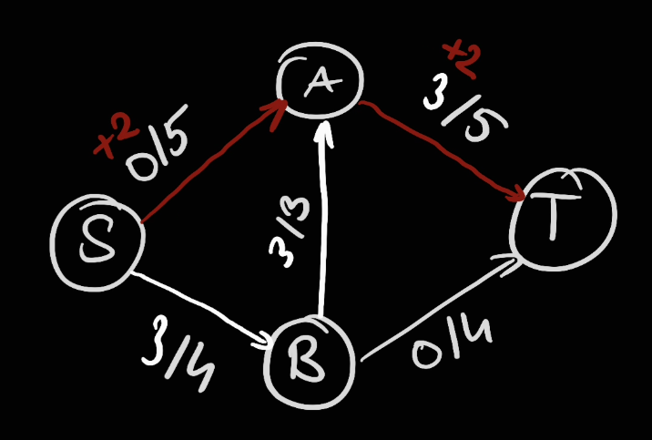

Bővítjük a folyamot az élek mentén 2-vel:
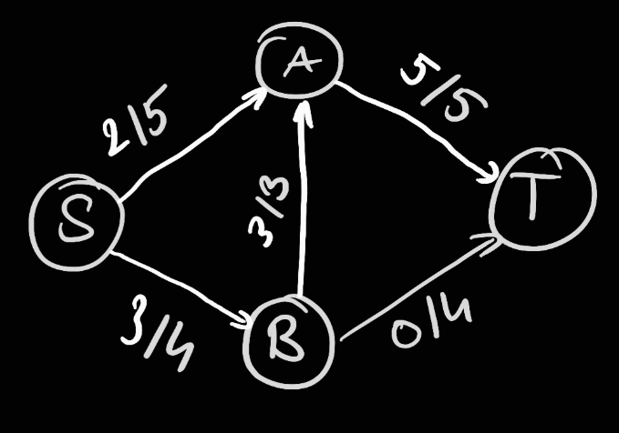

S-t útvonal, amin a bottleneck a maradék 1 kapacitás az S-B élen:
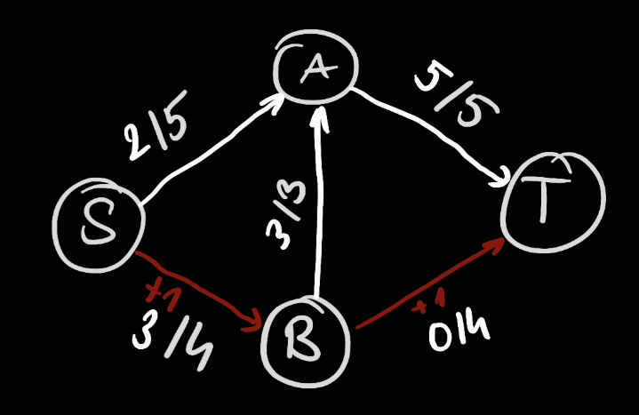

Bővítjük a folyamot az élek mentén 1-el:
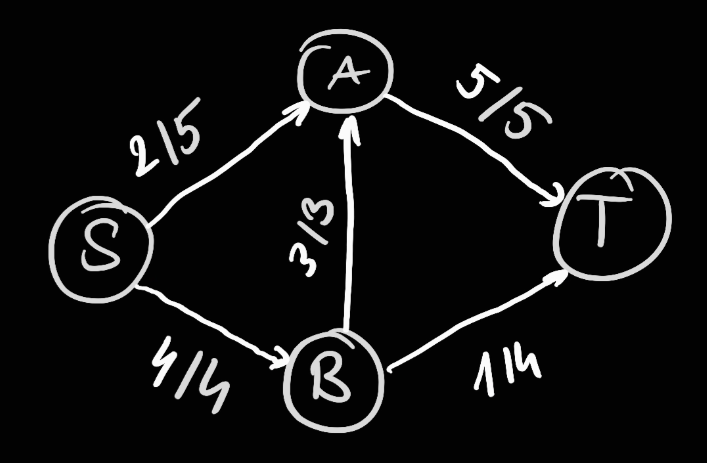

Probléma:
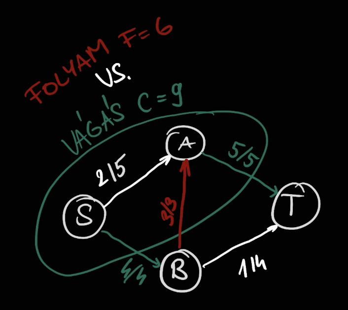

- A vágás 9, a folyam 6. Még nem vagyunk kész, de már nincs út.
- Probléma: a piros élet "elrontottuk", hibás döntés volt azt használni.
- Megoldás: vissza kellene vonni a felhasználást.
- Hogyan: minden felhasznált kapacitáshoz vegyünk fel ekkora kapacitású visszaélet.
  - Ezt az útonalkeresés megtalálhatja és azon bővítve a folyamot visszavonhtja a korábbi döntést (csökkentheti a felhasznált kapacitást).

Lila élek: annyi kapacitással amennyit az eredeti folyam elhasznált.
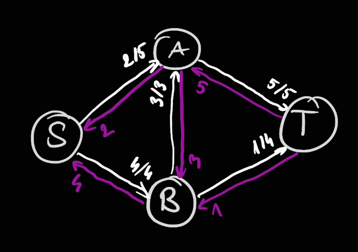

Ezen a ponton a fehér éleken elég a "maradék" kapacitásokat tárolni, az eddigi f/c számok helyett a c-f értéket:
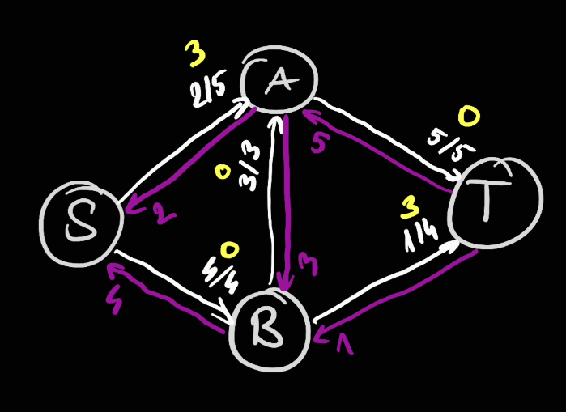

Sárga élek: mennyi kapacitást lehet még elhasználni.
Lila élek: mennyi elhasznált kapacitást lehet visszavonni.
= Minden lehetséges változtatás az aktuális folyamunkon!
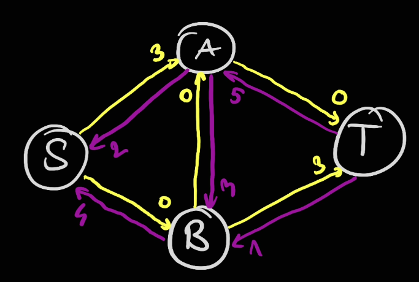

Az átláthatóság kedvéért a 0 kapacitású éleket ne ábrázoljuk:
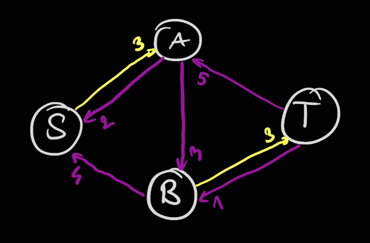

Ekkor már látszik is az új javító út, ami a B-A élet visszavonja:
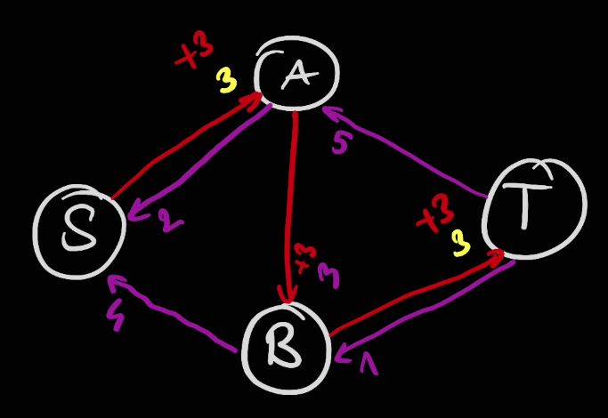

Frissítjük a maradék hálózatot:
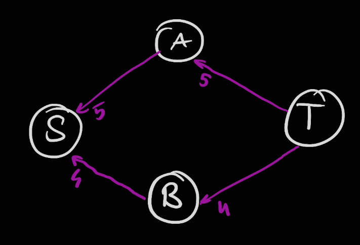

Vágás kapacitása = folyam értéke. Készen vagyunk, nincs S-T út.
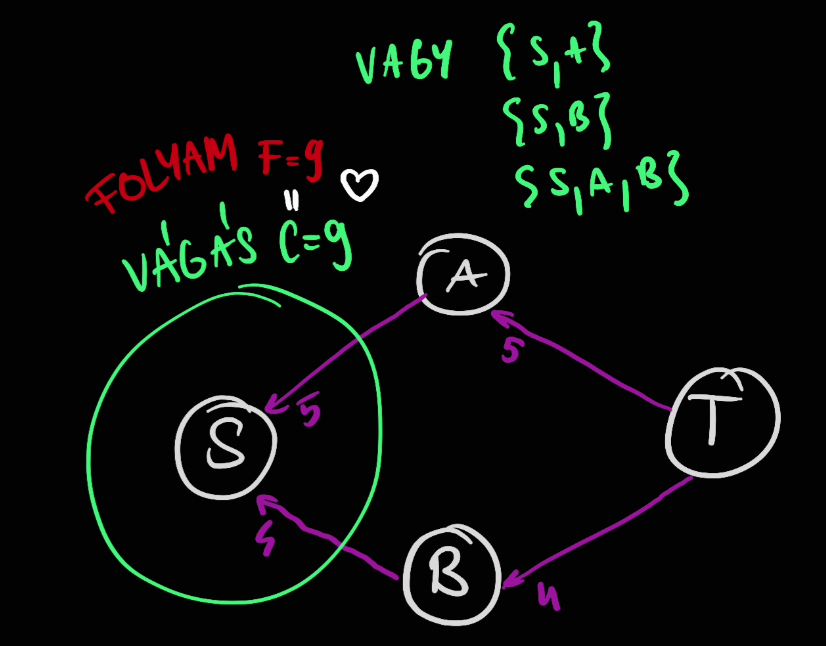

https://youtu.be/LdOnanfc5TM

#### Edmonds-Karp

- A Ford-Fulkerson módszer nem specifikálja hogyan keressük a javító utat.
- Kereshetjük például: DFS, BFS, Dijkstra, stb.
- DFS: Túl hosszú utakat talál, amin valószínű, hogy csak 1-el tudunk javítani. Emiatt $O(fE)$ a futásideje, ahol $f$ a max folyamérték.
- BFS: Edmonds-Karp
- $O(VE^2)$

https://youtu.be/RppuJYwlcI8
https://cp-algorithms.com/graph/edmonds_karp.html

#### Dinic

- $O(V^2E)$.
  - Speciális esetek:
    - Páros gráfokon $O(\sqrt{V}E)$, [lásd Hopcroft–Karp](https://en.wikipedia.org/wiki/Hopcroft%E2%80%93Karp_algorithm).
    - Ha minden élkapacitás 1, akkor $O(min(V^{\frac{2}{3}}, E^{\frac{1}{2}})E)$.
- Ugyanúgy a maradék hálózaton keres javító utat, de azt ügyesebben.
- Egy BFS + DFS kombinációt használ, ami ordóban gyorsabbra jön ki.

- 1. fázis: BFS
  - A maradék gráfon futtat egy BFS-t és felcímkézi a csúcsokat az alapján hogy milyen távol vannak a source-tól. = Level graph (szint gráf?)
  - Csak azokat az éleket hagyja meg ahol a szintkülönbség pont 1. Tehát:
    - Nincs visszaél kisebb szintre.
    - Nincs keresztél azonos szinten belül.
    - Egynél nagyobb szintkülönbségű előreél nem lehet, mert akkor a BFS-nek hamarabb meg kellett volna találnia az él végét.
- 2. fázis: DFS-ek
  - A szintgráfon keres javítóutat DFS-el amíg talál.
  - Ha egy DFS "dead end"-be ütközik, akkor kifele jövetel közben (DFS bakctrackje) felcímkézi a csúcsokat hogy oda legközelebb már ne menjünk be.
    - A rekurzív hívás végén az adott csúcsra megnézi hogy van-e nem blokkolt szomszédja. Ha nincs akkor blokkolt a csúcs is.
  - Blokkolt csúcsokba következő DFS már nem megy be.

Ezt ismételgeti amíg a BFS-el elérhető a source-ból a target.

https://youtu.be/M6cm8UeeziI
https://codeforces.com/blog/entry/104960
https://cp-algorithms.com/graph/dinic.html

### Megjegyzések

#### EgÉr lemma

- Egészértékűségi lemma.
- Ha a hálózatban minden kapacitás egész, akkor van olyan maximális folyam ami minden élen egész értékű.
- A javítóutas algoritmus ilyet fog találni.

#### Maximális párosítás keresése folyammal

A páros gráfban maximális párosítás keresése feladat:
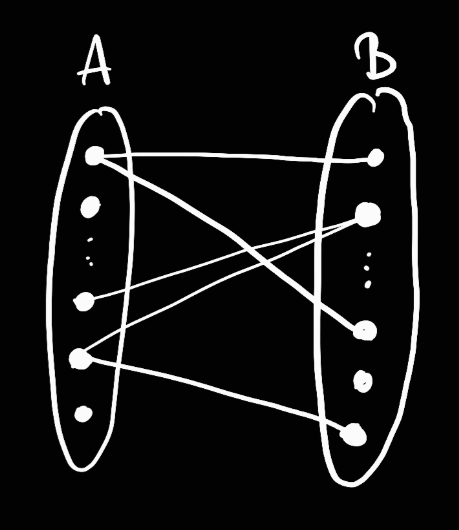

Is megoldható folyammal:
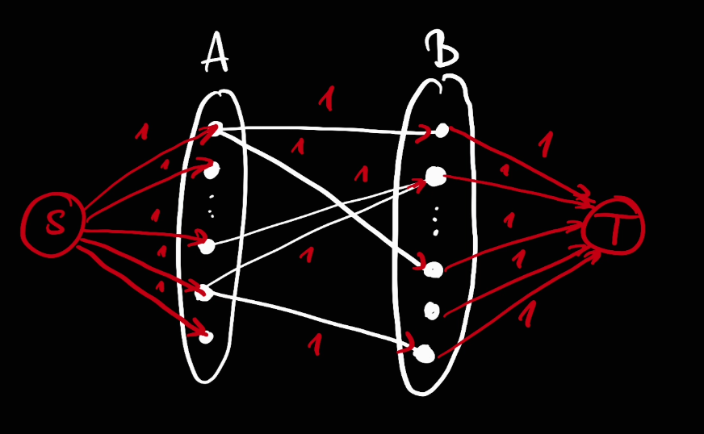

- Felveszünk +2 csúcsot, 1 source és 1 target.
- Source-ból bekötünk minden A-beli csúcsot 1 kapacitással.
- Target-ba bekötünk minden B-beli csúcsot 1 kapacitással.
- A->B irányban megirányítjuk a közbenső éleket 1 kapacitással.
- Max folyam = max párosítás.

### Általánosítás

#### Irányítatlan gráfok

- Irányítsuk meg mindkét irányba az összes élet és írjuk mindkét példányra az eredeti él kapacitását.
- A maximális folyam úgyis csak az egyik irányt fogja használni, hiszen ha mindkettőt használja az helyettesíthető a különbséggel a nagyobbik irányba.
- A minimális vágáshoz csak az egyik irányú élet kell kivenni. A kivett él kezdőpontja a source oldalán lesz, a végpontja a target oldalán.

#### Csúcskapacitások

- "Húzzuk szét" őket élekre.
- Mindegyik csúcsot 2 csúccsal és egy irányított éllel helyettesítünk.
- Az egyik új csúcs megkapja az eredeti beéleit, ebből mutat a másik csúcsba az új él, ami megkapja az eredeti kiéleit.

#### Több source/target

- Vegyünk fel egy új "master source" és "master target" csúcsot.
- Végtelen kapacitásokkal vegyünk fel kiéleket a "master source"-ból az eredetiek felé.
- Végtelen kapacitásokkal vegyünk fel beéleket a "master target"-be az eredetiek felől.

## Segédprogramok

- [Fibonacci: rekurzió, memoizálás és dinamikus programozás](../kodok/2022/fibonacci.cpp)
- [C++-sablon](../kodok/2022/sablon.cpp)
- [Hibakeresési segédfüggvények](../kodok/2022/debug.h)
- [Eredeti kiértékelőszkript](../kodok/2022/eval.sh)
