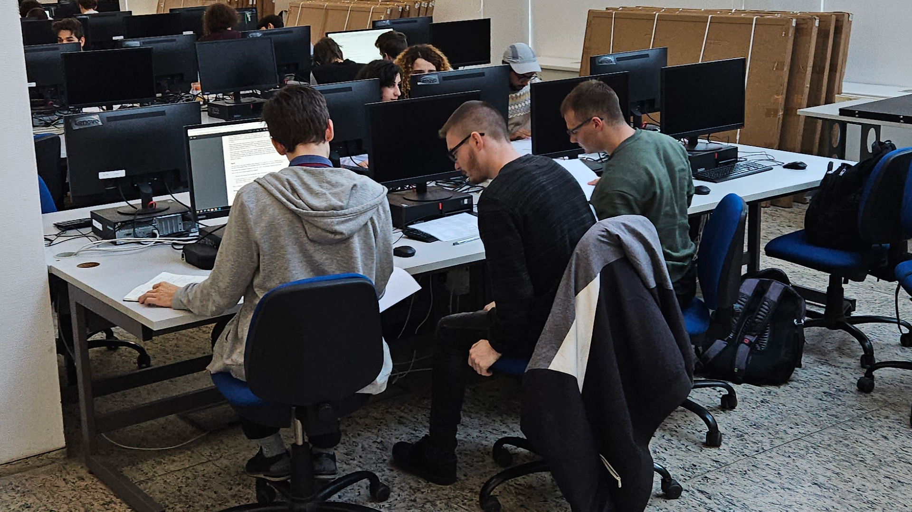
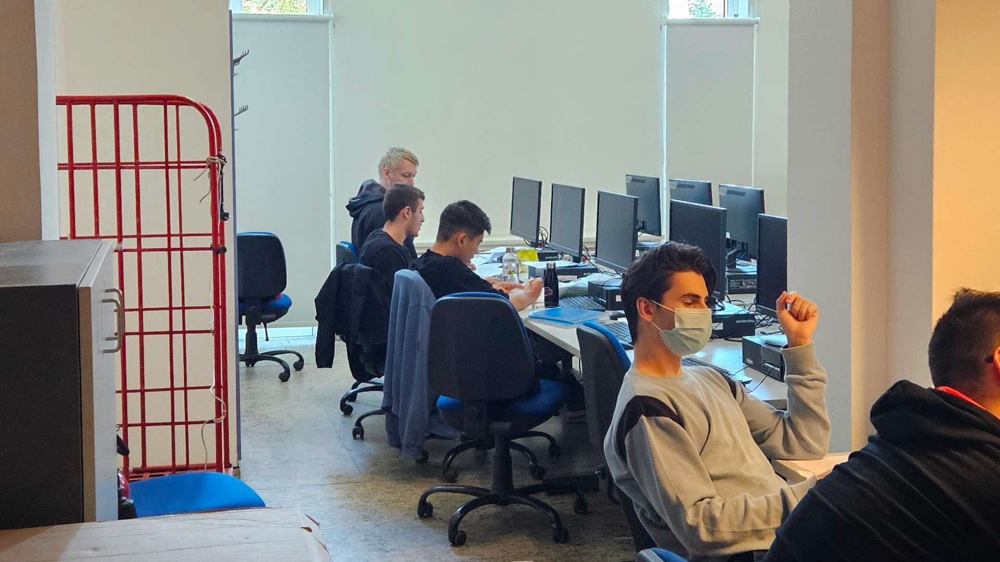
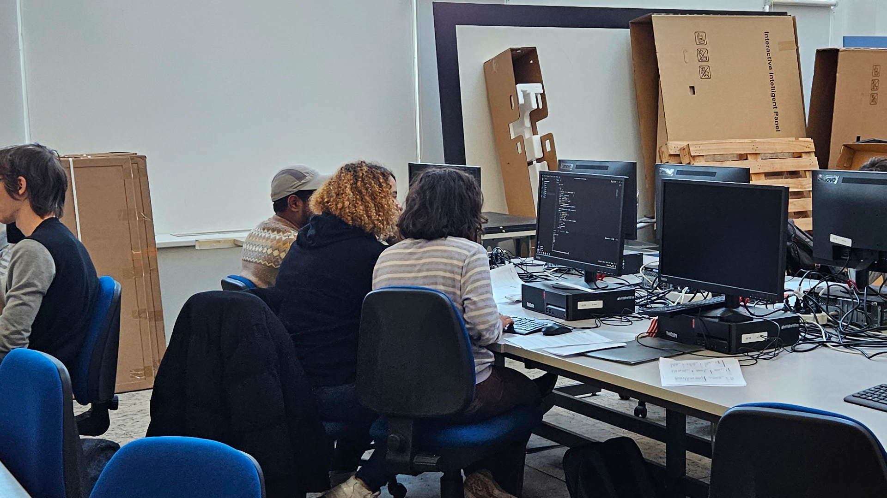

# Versenyprogramozás - 2023

## 2023-02-26 - VProg Student Club - Spring 2023

The VProg competitive programming study groups are continued this semester, organized by [BME VIK SZIT](http://cs.bme.hu/english/)!

In the study groups we solve Codeforces and  LeetCode-style exercises together, using C++ and Python, in a 'mob programming' format. Our goal is to prepare for the ACM ICPC competitions, held every year in the autumn semesters.

We welcome anyone who is interested in algorithms! :)

The sessions are online, on Discord.

### First session

- **Time**: 2023 March 10 (Friday) 15:00 - 17:00
- **Join**: <https://vprog.hu/discord>

### Contact

- **Site**: <https://versenyprogramozas.hu/>
- **E-mail**: [nemkin@cs.bme.hu](mailto:nemkin@cs.bme.hu)

## 2023-09-01 - VProg Student Club - Fall 2023

The VProg competitive programming study groups are continued this semester, organized by [BME VIK SZIT](http://cs.bme.hu/english/)!

The study groups' aim is to work together on improving our competitive programming skills and expanding our knowledge on data structures and algorithms. We solve LeetCode-style exercises on platforms such as Codeforces, SPOJ, etc, in a ['mob programming'](https://en.wikipedia.org/wiki/Team_programming#Mob_programming) format, mostly using C++ and Python.

We welcome anyone who is interested in competitive programming (however, some basic knowledge of algorithms, such as sorting, binary search, graph travelsals, shortest path, etc and basic programming skills are a must-have, to be able to keep up)!

The sessions are held online, on Discord. We run both a Hungarian and an English session! :)

### Coordinates (Budapest time)

- **VProg-HU**: Fridays, 16:00 - 18:00
  - Starting on 2023 September 15.
  - Hungarian-speaking.

- **VProg-EN**: Mondays, 17:30 - 19:30
  - starting on 2023 September 11.
  - English-speaking.

**Join us on Discord**: <https://vprog.hu/discord>

**Contact**: [Viktória Nemkin](http://www.cs.bme.hu/~nemkin/) ([nemkin@cs.bme.hu](mailto:nemkin@cs.bme.hu))

## 2023-09-28 - ICPC 2023 Registration

### 1st Round: Hungarian Qualifications

The 1st round will be held on **2023 October 14**, organized by ELTE.

<http://versenyek.inf.elte.hu/2023/09/28/icpc-2023/>

#### Registration

<https://forms.gle/y6WwLRJiPp2mdeYk7>

**Deadline**: 2023 October 10

Looking for teammates? Join us on [Discord](https://vprog.hu/discord) and make a post in the *#find-a-teammate* channel!

**Contact for BME teams**: [Dr. Katalin Friedl](http://www.cs.bme.hu/~friedl) ([friedl@cs.bme.hu](mailto:friedl@cs.bme.hu))

#### Eligibility criteria

Your team must meet the following criteria:

- Consists of 3 people.
- All members are currently enrolled at BME (Erasmus students, please email us).
- All members began post-secondary studies in 2019 or later OR were born in 2000 or later.

#### Coordinates

- **Date**: 2023 October 14
- **Time**:
  - Instructions, Practice Round: 9:00 - 10:00
  - Contest: 10:00 - 15:00
- **Location**:
  - Building: [Lágymányosi ELTE Campus, Southern Block](https://goo.gl/maps/c3KgQrZBMH2mBtmq5)
  - Room: [0.308 (Lovarda)](../abrak/kepek/elte-ik-deli-epulet-lovarda.png)

### 2nd Round: Central European Regional Contest

**The top 2 eligible teams from BME advance to the next round.**

Your team must have competed in the 1st Round (Hungarian Qualifications) and placed in the top 2 eligible teams from BME.

The CERC will be held between 2023 December 8-10 in Ljubljana, Slovenia, by the [University of Ljubljana, Faculty of Computer and Information Science](https://goo.gl/maps/ykUS8cy3s8FL17rN9).

<https://cerc.acm.si/>

Travel and stay is organized and funded by BME for the 2 eligible teams.

## 2023-10-14 - ICPC Hungary 2023 results

As the first round of ICPC is over, we applaud our university's teams for their performance!

During the contest, the teams had to solve 12 challenging algorithmical problems in either C++, Python or Java. All three of our teams have been working hard on improving their programming and problem solving skills in the past year to prepare for this contest and we are proud of their results. :)

### Problemset

|  |  |  |  |  |  |  |  |  |  |  |  |
| --- | --- | --- | --- | --- | --- | --- | --- | --- | --- | --- | --- |
| **[A](../pdfek/2023/icpc-hungary-2023.pdf#page=1)** | **[B](../pdfek/2023/icpc-hungary-2023.pdf#page=3)** | **[C](../pdfek/2023/icpc-hungary-2023.pdf#page=5)** | **[D](../pdfek/2023/icpc-hungary-2023.pdf#page=7)** | **[E](../pdfek/2023/icpc-hungary-2023.pdf#page=8)** | **[F](../pdfek/2023/icpc-hungary-2023.pdf#page=10)** | **[G](../pdfek/2023/icpc-hungary-2023.pdf#page=11)** | **[H](../pdfek/2023/icpc-hungary-2023.pdf#page=13)** | **[I](../pdfek/2023/icpc-hungary-2023.pdf#page=15)** | **[J](../pdfek/2023/icpc-hungary-2023.pdf#page=16)** | **[K](../pdfek/2023/icpc-hungary-2023.pdf#page=17)** | **[L](../pdfek/2023/icpc-hungary-2023.pdf#page=18)** |

### Results from BME

| Rank |       Team       | Members                                               |
|:----:|:----------------:|:------------------------------------------------------|
|   6  |        LSZ       | Levente Gegő, Soma Szatmári, Zoltán Szatmáry          |
|  18  |        DSU       | Azam Rakhmatillaev, Benedek Brandschott, Klevis Imeri |
|  21  | TheQuantumHomies | Balkis Karoui, Bhaskar Sharma, Nia Tatrishvili        |

[Full scoreboard](https://icpc-hungary.github.io/)

### During contest

_LSZ_

_DSU_

_TheQuantumHomies_

Congratulations to everyone and see you next year!
