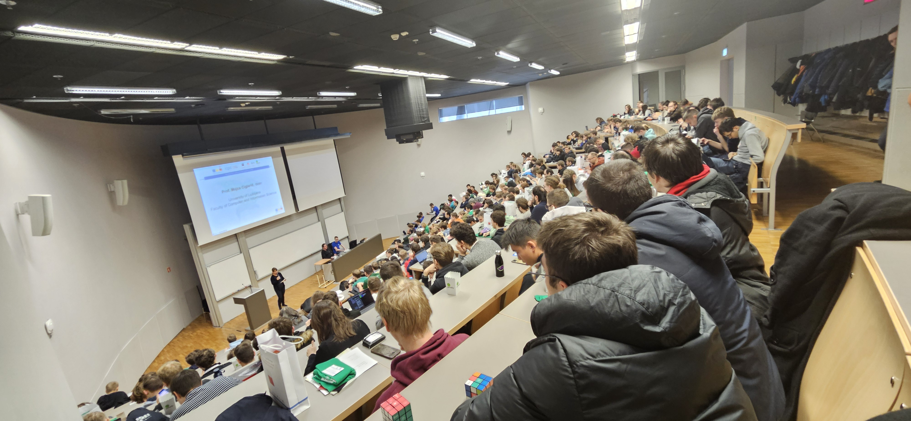
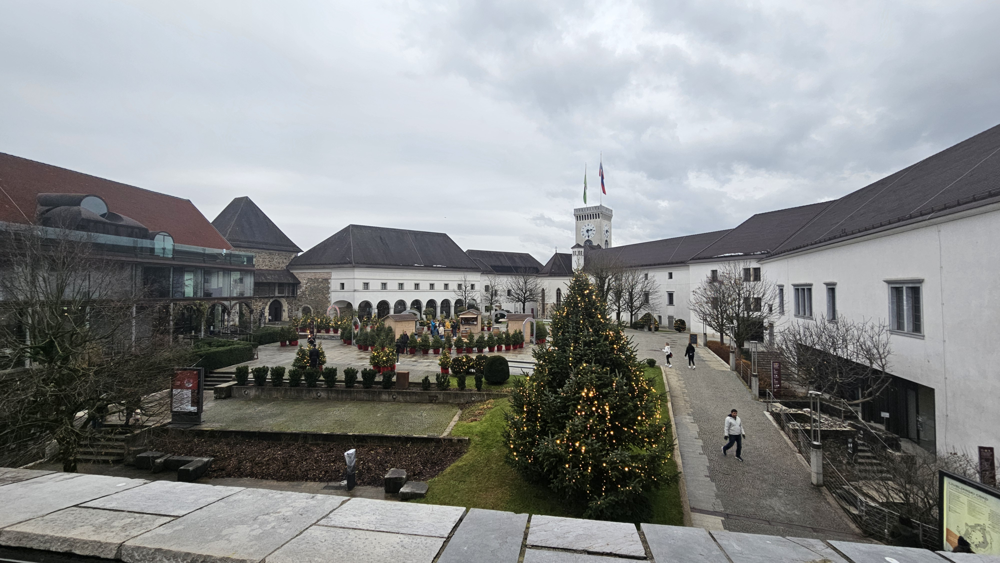

# Versenyprogramozás - 2024

## 2024-02-16 - VProg Student Club - Spring 2024

The VProg competitive programming study groups are continued this semester, organized by [BME VIK SZIT](http://cs.bme.hu/english/)!

The study groups' aim is to work together on improving our competitive programming skills and expanding our knowledge on data structures and algorithms. We solve LeetCode-style exercises on platforms such as Codeforces, SPOJ, etc, in a ['mob programming'](https://en.wikipedia.org/wiki/Team_programming#Mob_programming) format, mostly using C++ and Python.

We welcome anyone who is interested in competitive programming!

We run two levels:

- **VProg Introductory**: Recommended for those, who have some basic knowledge in algorithms, such as sorting, binary search, graph travelsals, shortest path, etc and basic programming skills.
- **VProg Advanced**: Recommended for those, who have done competitive programming in the past (e.g. Nemes Tihamér, OKTV Programming, CEOI, IOI, Codeforces).

Language is English by default, unless only Hungarians are present.

### Coordinates

- **VProg Advanced**: Mondays 12:15 - 15:00 and Wednesdays 14:15 - 17:00
  - Starting on 2024 February 19.
  - Live @ BME, in room IB134.
- **VProg Introductory**: Fridays 16:00 - 18:00
  - Starting on 2024 February 23.
  - Online, on Discord.

**Join us on Discord**: <https://vprog.hu/discord>

**Contact**: [Viktória Nemkin](http://www.cs.bme.hu/~nemkin/) ([nemkin@cs.bme.hu](mailto:nemkin@cs.bme.hu))

## 2024-02-28 - ICPC CERC 2023 results

As the Central Europe Regional Contest of the ICPC concludes, we congratulate our teams LSZ and DSU for their results!

In December 2023, our university competed against teams from eight countries across Europe. Team LSZ with Levente Gegő, Soma Szatmári and Zoltán Szatmáry secured the 42nd place regionally, while DSU comprising Azam Rakhmatillaev, Benedek Brandschott and Klevis Imeri ranked 57th.

During the contest, the students were tasked with solving [12 challenging exercises](../pdfek/2023/icpc-cerc-2023.pdf), requiring a deep understanding of data structures and algorithms and the ability to apply these creatively under pressure. The teams had to collaborate effectively, distributing tasks and combining their problem-solving skills to tackle the tasks presented.

_Members of both teams before the contest_

The competition took place in Slovenia, hosted by the Faculty of Computer and Information Science at the University of Ljubljana. We're grateful to them for organizing the competition and our sponsor, the Faculty of Electrical Engineering and Informatics from our university for funding the travel of our team members and coach to Slovenia for the event.

_Ljubljana_

We have spent the last year training hard in preparation for this competition, and we are determined to step up our performance for next year, doubling our training sessions to twice a week, dedicating three hours each time! We invite you to join us at [VProg](#2024-02-16---vprog-student-club---spring-2024) and be part of our next year's roster! :)

## 2024-09-09 - VProg Student Club - Autumn 2024

The VProg competitive programming study groups are continued this semester, organized by [BME VIK SZIT](http://cs.bme.hu/english/)!

**Join us on Discord**: <https://vprog.hu/discord>

### VProg Intro

Aimed at 2nd year software engineers at BME, who are just starting out with competitive programming.

This semester, we decided to turn VProg Intro into a video series, coming out weekly on Fridays.

More details in the first video - uploaded a bit earlier - check it out here: <https://youtu.be/j_AS8H_99uw>

### VProg Advanced

**Tuesdays 18:00, room IB134**

If you have former experience in competitive programming (aka Nemes Tihamér, OKTV Programming II, IOI, CEOI, ICPC, Codeforces, etc), join us in the advanced sessions.

**Contact**: [Viktória Nemkin](http://www.cs.bme.hu/~nemkin/) ([nemkin@cs.bme.hu](mailto:nemkin@cs.bme.hu))

## 2024-10-01 - ICPC Hungary 2024: Algorithmic programming competition for teams

The [International Collegiate Programming Contest](https://icpc.global) (ICPC, formerly known as ACM ICPC)
is one of the oldest, largest, and most prestigious competitive programming contests for college students
in the world. The first round, ICPC Hungary is held every year at ELTE University.

In this contest, teams of three compete against the other teams and the time. Problems must be solved and submitted
in either C++, Java, or Python. It is beneficial for the teams to have at least one member who is familiar with
basic graph algorithms and data structures, and someone who has good programming skills. You can check out the
exercises from last year [here](../pdfek/2023/icpc-hungary-2023.pdf). If you're
interested and/or don't have a team yet, join our competitive programming student club,
VProg on [Discord](https://vprog.hu/discord)!

The two best teams from BME participating in the competition will have the opportunity to represent our
university in the regional round, which will be held later this year in Wrocław.

### ICPC Hungary

Your team **must be** registered in order to compete. The registration deadline is **13 October 2024**.

#### Eligibility

- Teams of 3 students.
- All team members must be currently enrolled at BME.
- Members must have started post-secondary studies in 2020 or later OR were born in 2001 or later.

#### How to register

Send an email to Prof. Katalin Friedl at [friedl@cs.bme.hu](mailto:friedl@cs.bme.hu) with
the following information in either English or Hungarian till **13 October**:

**Subject**: ICPC registration  
**Contents**:
- Team name
- For each team member:
  - Name
  - Email address
  - Year, Degree, Major (e.g. 3rd year, BSc, software engineering)

#### Event details

- **Date**: 19 October 2024 (Saturday)
- **Time**:
  - Instructions, Practice Round: TBD
  - Contest: 10:00 - 15:00
- **Location**:
  - Building: [Lágymányosi ELTE Campus, Southern Block](https://goo.gl/maps/c3KgQrZBMH2mBtmq5)
  - Room: [0.308 (Lovarda)](../abrak/kepek/elte-ik-deli-epulet-lovarda.png)

### ICPC CERC (Central European Regional Contest)

The round is invitation-only, BME delegates the top 2 teams from ICPC Hungary.

CERC will be held between 13-15 December 2024 in Wrocław, Poland.

More info: <http://cerc24.ii.uni.wroc.pl>

Travel and accomodation for the two qualifying teams will be organized by BME.

### Posters

[English poster](../pdfek/2024/icpc-hungary-2024-plakat-en.pdf)
[Magyar plakát](../pdfek/2024/icpc-hungary-2024-plakat-hu.pdf)
