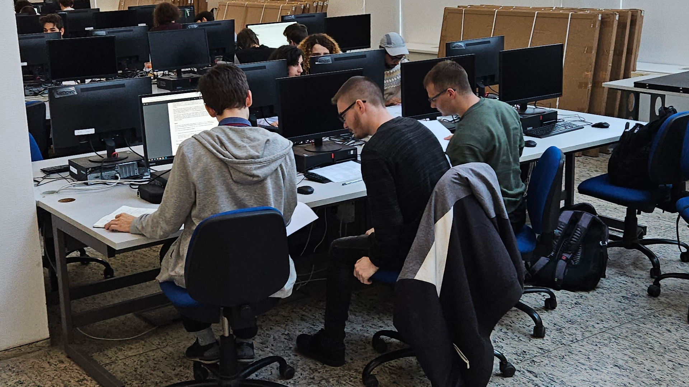
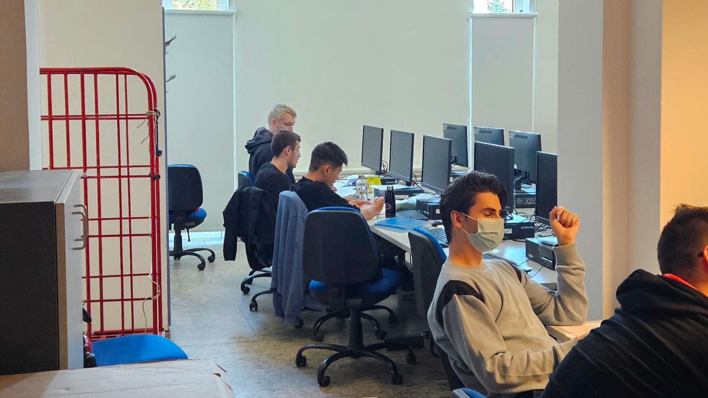
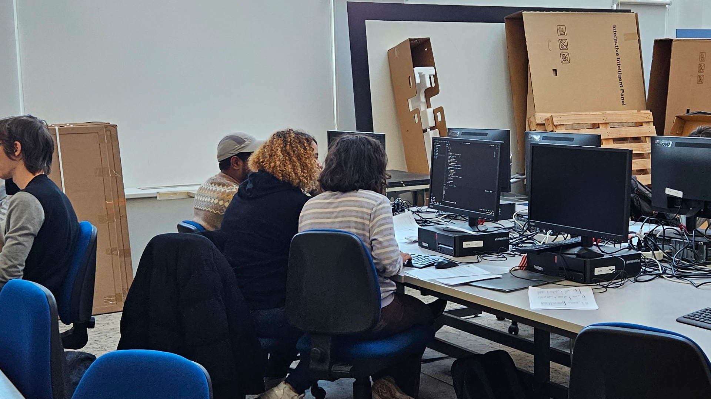

# Hírek és eredmények (2023)

## News

#### ICPC Hungary Results

As the first round of ICPC is over, we applaud our university's teams for their performance!

During the contest, the teams had to solve 12 challenging algorithmical problems in either C++, Python or Java. All three of our teams have been working hard on improving their programming and problem solving skills in the past year to prepare for this contest and we are proud of their results. :)

##### Problemset

|  |  |  |  |  |  |  |  |  |  |  |  |
| --- | --- | --- | --- | --- | --- | --- | --- | --- | --- | --- | --- |
| **[A](pdfek/2023/icpc-hungary-2023.pdf#page=1)** | **[B](pdfek/2023/icpc-hungary-2023.pdf#page=3)** | **[C](pdfek/2023/icpc-hungary-2023.pdf#page=5)** | **[D](pdfek/2023/icpc-hungary-2023.pdf#page=7)** | **[E](pdfek/2023/icpc-hungary-2023.pdf#page=8)** | **[F](pdfek/2023/icpc-hungary-2023.pdf#page=10)** | **[G](pdfek/2023/icpc-hungary-2023.pdf#page=11)** | **[H](pdfek/2023/icpc-hungary-2023.pdf#page=13)** | **[I](pdfek/2023/icpc-hungary-2023.pdf#page=15)** | **[J](pdfek/2023/icpc-hungary-2023.pdf#page=16)** | **[K](pdfek/2023/icpc-hungary-2023.pdf#page=17)** | **[L](pdfek/2023/icpc-hungary-2023.pdf#page=18)** |

##### Results from BME

| Rank | Team | Members |
| --- | --- | --- |
| 6 | LSZ | Levente Gegő Soma Szatmári Zoltán Szatmáry |
| 18 | DSU | Azam Rakhmatillaev Benedek Brandschott Klevis Imeri |
| 21 | The­Quantum­Homies | Balkis Karoui Bhaskar Sharma Nia Tatrishvili |

[Full scoreboard](https://icpc-hungary.github.io/)

##### During contest

|  |  |  |
| --- | --- | --- |
|  |  |  |

Congratulations to everyone and see you next year!

#### VProg Student Club

Fall 2023

**<http://versenyprogramozas.hu/>**

------------------------------------------------------------------------

!The VProg competitive programming study groups are continued this semester, organized by [BME VIK SZIT](http://cs.bme.hu/english/)!

The study groups' aim is to work together on improving our competitive programming skills and expanding our knowledge on data structures and algorithms. We solve LeetCode-style exercises on platforms such as Codeforces, SPOJ, etc, in a ['mob programming'](https://en.wikipedia.org/wiki/Team_programming#Mob_programming) format, mostly using C++ and Python.

We welcome anyone who is interested in competitive programming (however, some basic knowledge of algorithms, such as sorting, binary search, graph travelsals, shortest path, etc and basic programming skills are a must-have, to be able to keep up)!

The sessions are held online, on Discord. We run both a Hungarian and an English session! :)

------------------------------------------------------------------------

##### Coordinates

- **VProg-HU: Fridays, 4:00 pm - 6:00 pm (Budapest time)**
  - starting on 15 Sept. 2023
  - Hungarian-speaking
- **VProg-EN: Mondays, 5:30 pm - 7:30 pm (Budapest time)**
  - starting on 11 Sept. 2023
  - English-speaking

**Discord**: <https://vprog.hu/discord>

**Contact**: [Viktória Nemkin](http://www.cs.bme.hu/~nemkin/) ([`nemkin@cs.bme.hu`](mailto:nemkin@cs.bme.hu))

#### ICPC 2nd Round:

Central European Regional Contest

8-10 Dec. 2023

**<https://cerc.acm.si/>**

------------------------------------------------------------------------

##### Eligibility criteria

**Your team must have competed in the 1st Round (Hungarian Qualifications) and placed in the top 2 eligible teams from BME.**

------------------------------------------------------------------------

## Coordinates

- **Dates: 8-10 Dec. 2023**
- **Location**: [Faculty of Computer and Information Science, University of Ljubljana, Slovenia](https://goo.gl/maps/ykUS8cy3s8FL17rN9)

------------------------------------------------------------------------

Travel and stay is organized and funded by BME for the 2 eligible teams.

## ICPC 1st Round:

Hungarian Qualifications

14 Oct. 2023

Organized by ELTE:

**<http://versenyek.inf.elte.hu/2023/09/28/icpc-2023/>**\

------------------------------------------------------------------------

## Registration

<https://forms.gle/y6WwLRJiPp2mdeYk7>

**Deadline: 10 Oct. 2023**

Looking for teammates? Join us on [Discord](https://vprog.hu/discord) and make a post in the `#find-a-teammate` channel!

**Contact for BME teams**: [Katalin Friedl](http://www.cs.bme.hu/~friedl) ([`friedl@cs.bme.hu`](mailto:friedl@cs.bme.hu))

------------------------------------------------------------------------

## Eligibility criteria

Your team must meet the following criteria:

- Consists of 3 people.
- All members are currently enrolled at BME (Erasmus students, please email us).
- All members began post-secondary studies in 2019 or later OR were born in 2000 or later.

**The top 2 eligible teams from BME advance to the next round.**

------------------------------------------------------------------------

## Coordinates

- **Date**: 14 Oct. 2023
- **Time**:
  - Instructions, Practice Round: 9:00 am(?) - 10:00 am
  - Contest: 10:00 am - 3:00pm
- **Location**:
  - Building: [Lágymányosi ELTE Campus, Southern Block](https://goo.gl/maps/c3KgQrZBMH2mBtmq5)
  - Room: [0.308 (Lovarda)](abrak/kepek/elte-ik-deli-epulet-lovarda.png)

×
