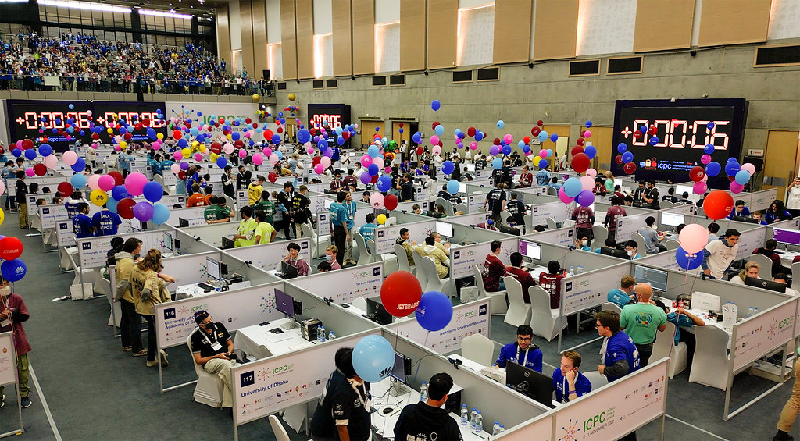

# Versenyprogramozás, felkészülés és kapcsolatok

## Competitive programming

Competitive programming is a mental sport (just like chess), where participants tackle a challenging set of algorithmical and mathematical problems by writing computer programs that can solve them.

Judging of the solutions is based on a large set of hidden testcases, for each of which the program must return the correct solution under a very tight time and memory limit. In order to pass these testcases, participants must employ their knowledge of various data structures and algorithms.

Practicing this sport will train you to think and code fast under pressure, enhance your problem solving skills, find bugs and edge cases in code quicker, understand the workings of complex algorithms and come up with creative solutions to problems. All of these skills translate well into any field in IT and will prepare you for FAANG interviews too. Also, it is fun!

## ICPC

The International Collegiate Programming Contest, known as the ICPC, is one of the oldest, largest, and most prestigious competitive programming contests among the universities of the world.

_ICPC World Finals 2021, Dhaka, Bangladesh_

[ICPC gallery](https://news.icpc.global/gallery/)

The competition is open to teams of three, who are currently enrolled at the same university and all members meet the [eligibility requirements](https://cerc.acm.si/#participation). The teams have 5 hours to work on 10-12 exercises, using a single computer, provided by the organizers. Using hand-written or printed materials is allowed, however other electronic devices (phones, calculators, pendrives) and the Internet are not.

There are four tiers of the competition:

- [ICPC Hungary](http://versenyek.inf.elte.hu)
- [ICPC CERC (Central European Regional Contest)](https://cerc.acm.si)
- [ICPC Europe Championship](https://euc.icpc.global/)
- [ICPC World Finals](https://icpc.global)

In the qualification round the first 2 teams from Budapest University of Technology and Economics will advance to the regional round. Travel and stay is organized and funded by the university for our teams.

## Preparation

### Mentality

This is key.

- **Don't overwhelm yourself.** Don't start with going online and buying an 800-page book on the theory of algorithms to try and read it from cover-to-cover. It will be difficult and boring. Instead, compile a list of topics you're interested in and pick one to tackle first. Find easily digestable sources, such as youtube tutorials or blog posts on that topic and try solving the exercises they link.
- **You're not too late.** It can be easy to feel like you're in a hurry to reach whatever standard you set for yourself for your current age. Then, you try to catch up as fast as possible, committing to an impossibly high workload. This is unsustainable and leads to burnout eventually. You should allow yourself to take breaks, rest, have fun and enjoy life too.
- **Quantity leads to quality.** Perfectionism is what's keeping you from improvement. If you are interested in competing, you should start competing. Don't wait around, telling yourself that you need to practice before you can start with it, because you'll never start that way. Yes, in the start, your results won't be good, but if you keep going, you'll improve. Keep showing up, allow yourself to 'fail' and enjoy the ride! (See the [origin of the parable](https://austinkleon.com/2020/12/10/quantity-leads-to-quality-the-origin-of-a-parable/).)
- **Don't let other people's success demotivate you.** No matter how good you get, there will always be people, who are better than you. It can be easy to feel stupid in comparison and envy those people, especially when they are your peers. Don't let this discourage you from your goals. Feel proud of what you have accomplished so far and instead of comparing you to everybody else, try to outdo yourself. Also, I encourage you to reach out and befriend these people instead. You might be surprised to learn, that they are approachable, friendly and may feel just like you do.
- **Ask for help.** If you're stuck with a problem or a concept, don't waste your time with it way too long. Ask other people to help you, so you can go onto learning the next topic instead. We are building a community of competitive programmers on Discord, make sure to [join us](https://vprog.hu/discord), if you're interested. :)

### Materials

#### English

- A very extensive topic list, for reference: [GeeksForGeeks: How to prepare for ACM - ICPC?](https://www.geeksforgeeks.org/how-to-prepare-for-acm-icpc)
- Explanations and source code: [cp-algorithms.com](https://cp-algorithms.com)
- University courses on Youtube for free, such as (pick what you like):
  [[1]](https://www.youtube.com/playlist?list=PLUl4u3cNGP63EdVPNLG3ToM6LaEUuStEY),
  [[2]](https://www.youtube.com/playlist?list=PLUl4u3cNGP61Oq3tWYp6V_F-5jb5L2iHb),
  [[3]](https://www.youtube.com/playlist?list=PLkToMFwOtNHiJtcBu0piSLKnLVGOF9vaV),
  [[4]](https://www.youtube.com/playlist?list=PL2SOU6wwxB0uP4rJgf5ayhHWgw7akUWSf),
  [[5]](https://www.youtube.com/@timroughgardenlectures1861/playlists)
- Competitions and practice problems: [Codeforces](https://codeforces.com)
- More practice problems:  [SPOJ](https://www.spoj.com), [Advent of Code](https://adventofcode.com)

#### Hungarian

- [BSZ1](http://cs.bme.hu/bsz1/jegyzet/bsz1_jegyzet.pdf),
  [BSZ2](http://cs.bme.hu/bsz2/bsz2_jegyzet.pdf) és
  [NESZ](http://www.cs.bme.hu/~fleiner/jegyzet/NESZ.pdf) jegyzet.
- Segédletek C és C++ programozáshoz: [InfoC porta](https://infoc.eet.bme.hu), [CPP FTW](https://prog2.cppftw.org)

## VProg student club

Versenyprogramozás (VProg) is a student club we run for college level competitive programming.

**Join us on Discord**: <https://vprog.hu/discord>

### Calendar

See upcoming meetings here.

**Add this to your Google Calendar**: <https://vprog.hu/calendar>

### Announcements

- [Spring 2024](felkeszito/2024.md#2024-02-16---vprog-student-club---spring-2024)
- [Fall 2023](felkeszito/2023.md#2023-09-01---vprog-student-club---fall-2023)
- [Spring 2023](felkeszito/2023.md#2023-02-26---vprog-student-club---spring-2023)
- [Fall 2022](felkeszito/2022.md#2022-09-01---vprog-student-club---fall-2022)

## Contact

Email the organizers: [`acm@cs.bme.hu`](mailto:acm@cs.bme.hu)

Subscribe to the mailing list: [`acm-valogato@cs.bme.hu`](http://www.cs.bme.hu/mailman3/postorius/lists/acm-valogato.cs.bme.hu/)

### Dr. Katalin Friedl

associate professor  
[IB137/a](https://www.szit.bme.hu/rolunk/kapcsolat.html)  
[friedl(at)cs.bme.hu](mailto:friedl@cs.bme.hu)  
[cs.bme.hu/~friedl](http://www.cs.bme.hu/~friedl/)

### Viktória Nemkin

PhD student  
[IE216/3](https://www.szit.bme.hu/rolunk/kapcsolat.html)  
[nemkin(at)cs.bme.hu](mailto:nemkin@cs.bme.hu)  
[cs.bme.hu/~nemkin](http://www.cs.bme.hu/~nemkin/)

Viktória Nemkin: [honlap](http://www.cs.bme.hu/~nemkin/), [Twitter](https://twitter.com/viktorianemkin).
